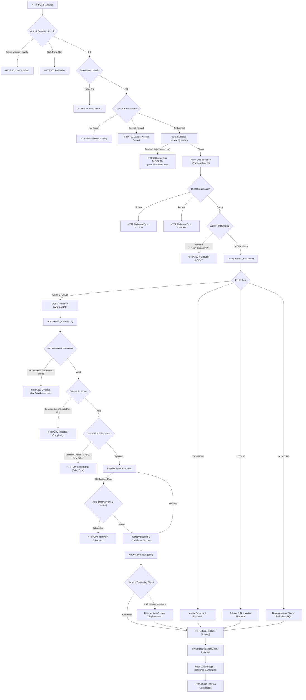

# CogniCore Codebase Dossier — Part 2: End-to-End Architecture

---

## 2.1 Request Lifecycle for `/api/chat`

The execution path for a chat query traverses Express middleware, security layers, input guards, deterministic routing, engine pipelines, grounding validation, PII masking, and audit logging.

| Step | Subsystem | Function Name | Code Location | Deterministic / LLM | Description & Data Transformed |
|---|---|---|---|---|---|
| **1** | HTTP Transport | Express Router Handler | `server/src/api/routes/chat.js:12` | Deterministic | Receives HTTP `POST /api/chat`. Validates that payload contains string `question`. Returns HTTP 400 if missing. |
| **2** | Authentication | `requireAuth(req, res, next)` | `server/src/security/rbac.js:68-80` | Deterministic | Reads `Authorization: Bearer <token>`. Decodes JWT via `verifyToken(token)` (`server/src/security/auth.js:19`). Checks `AuthRegistry.isSessionActive(token)` (`server/src/security/auth.registry.js:124`). Attaches user object to `req.user`. Returns 401 if missing/invalid. |
| **3** | Authorization | `requireCapability('query')` | `server/src/security/rbac.js:82-90` | Deterministic | Evaluates `hasCapability(req.user.role, 'query')`. Rejects low-privilege roles without query rights with HTTP 403. |
| **4** | Rate Limiting | `rateLimit()` middleware | `server/src/guardrails/rate.limit.js:16-36` | Deterministic | Checks in-memory request counter per IP/user window. Enforces `CHAT_RATE_LIMIT_PER_MIN` (default 30). Returns HTTP 429 if exceeded. |
| **5** | Dataset Access | `canRead(req.user, dataset)` | `server/src/api/routes/chat.js:24-36` | Deterministic | For each dataset ID in `datasetIds`, retrieves metadata from `DatasetRegistry.get(id)`. Validates ownership or `dataset_grants` entry via `canRead` (`server/src/security/rbac.js:92-101`). Returns 404 if missing, 403 if unauthorized. |
| **6** | Engine Orchestration | `handleUserQuery(options)` | `server/src/core/core.engine.js:38` | Hybrid | Core entry point. Initializes session state (`getOrCreateSession`), creates `Trace` recorder instance (`server/src/observability/trace.js:19`). |
| **7** | Input Guardrail | `screenQuestion(question)` | `server/src/guardrails/input.guard.js:29-50` | Deterministic | Runs regex pattern matching for prompt injection, jailbreaks, and config leakage. Enforces 4000-character limit. Short-circuits to refusal if blocked. |
| **8** | Follow-Up Rewriting | `resolveFollowUp(options)` | `server/src/core/followup.js:21-65` | LLM-Dependent | Heuristic check for anaphoric pronouns ("them", "that", "it"). If detected, invokes `rewriteProvider` (`qwen2.5:14b`) to produce a standalone self-contained question. |
| **9** | Intent Classification | `classifyIntent(effectiveQuestion)` | `server/src/core/intent.js:15-39` | Deterministic | Classifies intent into `'action'`, `'report'`, or `'query'` using static keyword and action-verb regexes. |
| **10** | Specialized Handlers | `proposeFromChat` / `buildManagementReport` | `server/src/core/core.engine.js:80-93` | Deterministic | If intent is `'action'` or `'report'`, routes to action approval store (`action.registry.js`) or report generator (`management.report.js`), bypassing data querying. |
| **11** | Agent Tools Shortcut | `tryAgent(options)` | `server/src/agent/agent.dispatcher.js:31-72` | Deterministic | For single structured datasets, inspects question for trend, forecast, anomaly, correlation, or KPI patterns. If matched, executes pure analytic mathematical algorithms. |
| **12** | Query Planning & Routing | `routeQuery(options)` | `server/src/core/query.router.js:21-62` | Deterministic | Calls `planQuery()` (`server/src/core/query.planner.js:18`). Determines route type (`STRUCTURED`, `DOCUMENT`, `HYBRID`, `ANALYSIS`) based on dataset file types. |
| **13** | Schema Discovery | `formatSchema(schema, semantic)` | `server/src/structured/schema.formatter.js:18-54` | Deterministic | Extracts table names, column types, sample categorical values, and primary/foreign keys from `cognicore_registry.db`. |
| **14** | SQL Generation | `generateSql(options)` | `server/src/structured/sql.generator.js:24-68` | LLM-Dependent | Formats system prompt with schema rules and dialect constraints. Dispatches to `llmProvider` (`qwen2.5:14b`). Strips markdown blocks. |
| **15** | Auto-Repair Pipeline | `prepareSql(sql, schema, semantic)` | `server/src/structured/sql.repair.js:19-61` | Deterministic | Applies 6 progressive deterministic repair heuristics (table singular/plural, FROM clause, column levenshtein/prefix, GROUP BY, integer division, value literals). |
| **16** | SQL Validation | `validateSql(sql, schema, dialect)` | `server/src/structured/sql.validator.js:15-139` | Deterministic | Parses AST with `node-sql-parser`. Whitelists `SELECT`. Validates table existence against schema. Rejects comments, DDL, DML, and multi-statements. |
| **17** | Complexity Gate | `analyzeComplexity(sql, schema)` | `server/src/structured/sql.complexity.js:24-69` | Deterministic | Evaluates join count ($\le 6$), subquery depth ($\le 4$), query length ($\le 4000$ chars), and estimated Cartesian fan-out ($\le 5\times 10^9$). |
| **18** | Data Policy Enforcement | `enforcePolicy(options)` | `server/src/security/data.policy.js:108-118` | Deterministic | Checks column denial policies (`assertColumnAccess`). Applies row-filtering policies via Common Table Expression (CTE) shadowing rewriting (`applyRowFilters`). Fails closed on MySQL. |
| **19** | Query Execution | `executeQuery(sql)` | `server/src/structured/sql.executor.js:22-54` | Deterministic | Dispatches read-only query to target adapter (`better-sqlite3`, `pg`, `mysql2`) with 15,000ms execution timeout and 1,000 row cap limit. |
| **20** | Auto-Recovery Loop | `recoverFromError(options)` | `server/src/structured/sql.recovery.js:24-73` | LLM-Dependent | If database throws a runtime syntax/catalog error, feeds error message back to model for up to 2 retry attempts. |
| **21** | Result Validation | `validateResult(rows, query)` | `server/src/quality/result.validator.js:18-62` | Deterministic | Audits output rows: checks empty results, anomalous magnitude spikes, negative values on counts/sums, and bounds reconciliation. |
| **22** | Confidence Scoring | `scoreConfidence(components)` | `server/src/evidence/confidence.scorer.js:19-84` | Deterministic | Computes 0.0–1.0 score across schema match, query clean run, completeness, consistency, and evidence rows. Weakest component caps level. |
| **23** | Answer Synthesis | `composeAnswer(reasoningProvider, ...)` | `server/src/response/answer.composer.js:21-65` | LLM-Dependent | Dispatches question and evidence rows to `reasoningProvider` to draft an explanatory natural language response. |
| **24** | Numeric Grounding | `applyGrounding(final, question)` | `server/src/core/core.engine.js:138-147` | Deterministic | Extracts numbers from model answer via regex. Validates each against evidence cells. Replaces answer with deterministic template if fabricated numbers detected. |
| **25** | PII Masking | `redactEvidence(evidence, semantic, role)` | `server/src/guardrails/pii.js:33-54` | Deterministic | For `viewer` and `employee` roles, masks emails, phone numbers, and SSNs in evidence cells and answer text using regex detectors. |
| **26** | Presentation Formatting | `finalize(options)` | `server/src/core/core.engine.js:162-214` | Deterministic | Attaches rule-based chart configuration (`chart.selector.js`), auto-generated statistical insights, and follow-up suggestion chips. |
| **27** | Audit Logging | `AuthRegistry.appendAudit(event)` | `server/src/security/audit.log.js:12-42` | Deterministic | Appends execution record to `audit_events` table in SQLite registry. Strips private audit block from result object. |
| **28** | HTTP Response | Express Handler Send | `server/src/api/routes/chat.js:52` | Deterministic | Dispatches sanitized JSON payload to client with HTTP status 200. |

---

## 2.2 Route Decision Architecture

Route selection is executed inside `planQuery()` (`server/src/core/query.planner.js:18-72`) based purely on structural dataset types:

```text
STRUCTURED_TYPES = Set(['sqlite', 'postgres', 'mysql', 'csv', 'xlsx', 'json'])
DOCUMENT_TYPES   = Set(['pdf', 'docx', 'txt', 'pptx'])
```

1. **`STRUCTURED` Route**:
   - **Trigger**: Exactly one structured dataset selected (`structuredDatasets.length === 1 && documentDatasets.length === 0`).
   - **Operation**: Natural language $\to$ SQL drafting $\to$ repair $\to$ AST validation $\to$ policy CTE shadowing $\to$ database execution $\to$ grounding $\to$ explanation.
   - **Returns**: Markdown answer, executed query string, sample rows, confidence breakdown, provenance object.
2. **`DOCUMENT` Route**:
   - **Trigger**: Exactly one unstructured document dataset selected (`documentDatasets.length === 1 && structuredDatasets.length === 0`).
   - **Operation**: Question embedded $\to$ cosine similarity search over chunk vectors in SQLite $\to$ Top-$K$ passage retrieval $\to$ LLM synthesis with citations.
   - **Returns**: Markdown answer, retrieved passage chunks with page numbers and similarity scores.
3. **`HYBRID` Route**:
   - **Trigger**: Either $\ge 1$ structured dataset AND $\ge 1$ document dataset selected, OR multiple structured datasets selected concurrently (`structuredDatasets.length > 1`).
   - **Operation**: Executes structured queries against tabular databases AND vector retrieval against documents. Combines evidence objects into a unified context payload for LLM synthesis.
   - **Returns**: Cross-source synthesized answer, multi-part evidence array linking tabular rows and document passages.
4. **`ANALYSIS` Route**:
   - **Trigger**: User explicitly toggles `analysisMode: true` on a single structured dataset (`server/src/core/query.router.js:28-30`).
   - **Operation**: Multi-step decomposition. LLM generates a 3-step investigation plan $\to$ each sub-step executes via the full structured SQL pipeline $\to$ final comparative synthesis.
   - **Returns**: Executive summary, sub-step breakdown, concatenated query evidence trail.

---

## 2.3 End-to-End Pipeline Architecture (Mermaid Flowchart)



---

## 2.4 Pipeline Termination Points & Response Shapes

| Interception Point | Trigger Condition | Status Code | `routeType` | Returned JSON Structure |
|---|---|:---:|---|---|
| **Middleware Auth** | Missing/invalid bearer token | `401` | `null` | `{"error": true, "message": "Authentication required"}` |
| **Middleware RBAC** | Role lacks `query` capability | `403` | `null` | `{"error": true, "message": "Forbidden"}` |
| **Middleware Rate Limit** | Requests $> 30/\text{min}$ | `429` | `null` | `{"error": true, "message": "Rate limit exceeded (...). Please slow down."}` |
| **Dataset Resolution** | Dataset ID missing from registry | `404` | `null` | `{"error": true, "message": "Dataset \"...\" not found."}` |
| **Dataset Grant** | User not owner and no share grant | `403` | `null` | `{"error": true, "message": "You do not have access to dataset \"...\"."}` |
| **Input Guardrail** | Injection pattern or $>4000$ chars | `200` | `BLOCKED` | `{"sessionId": "...", "routeType": "BLOCKED", "answer": "I can only answer questions about your connected data...", "evidence": null, "lowConfidence": true, "guardrail": {"flags": ["prompt_injection"]}}` |
| **Action Intent** | Natural language proposes action | `200` | `ACTION` | `{"sessionId": "...", "routeType": "ACTION", "answer": "...", "evidence": null, "lowConfidence": false, "action": {...}}` |
| **Report Intent** | Role forbidden from reports | `200` | `REPORT` | `{"sessionId": "...", "routeType": "REPORT", "answer": "Your role (...) is not allowed to generate management reports.", "evidence": null, "lowConfidence": true}` |
| **SQL AST Failure** | Model generated DML or invalid AST | `200` | `STRUCTURED` | `{"sessionId": "...", "routeType": "STRUCTURED", "answer": "I couldn't generate a valid query for this question.", "evidence": null, "lowConfidence": true}` |
| **Complexity Rejection** | Query exceeded join/depth/fanout | `200` | `STRUCTURED` | `{"sessionId": "...", "routeType": "STRUCTURED", "answer": "The generated query was too complex to execute safely.", "evidence": null, "lowConfidence": true}` |
| **Policy Denial** | Query touched denied column | `200` | `STRUCTURED` | `{"sessionId": "...", "routeType": "STRUCTURED", "answer": "Access denied: ...", "evidence": null, "lowConfidence": true, "denied": true}` |
| **Recovery Exhaustion** | SQL runtime error persisted retries | `200` | `STRUCTURED` | `{"sessionId": "...", "routeType": "STRUCTURED", "answer": "I encountered an error running the query...", "evidence": null, "lowConfidence": true, "recoveryAttempts": 2}` |
| **Grounding Fallback** | LLM synthesized unbacked numbers | `200` | `STRUCTURED` | `{"sessionId": "...", "routeType": "STRUCTURED", "answer": "<deterministic template>", "evidence": {...}, "guardrail": {"flags": ["ungrounded_numbers_replaced"]}, "lowConfidence": false}` |

---

## 2.5 Complete Contract of the Result Object

Constructed in `server/src/core/core.engine.js:188-213`:

| Field Name | Type | When Present | Setting Stage & Receipt | Description |
|---|---|---|---|---|
| `sessionId` | `string` | Always | Initialization (`core.engine.js:43`) | Session UUID (`ses_*`) |
| `routeType` | `string` | Always | Router (`core.engine.js:190`) | `'STRUCTURED'`, `'DOCUMENT'`, `'HYBRID'`, `'ANALYSIS'`, `'AGENT'`, `'ACTION'`, `'REPORT'`, `'BLOCKED'` |
| `answer` | `string` | Always | Synthesis / Fallback (`core.engine.js:191`) | Markdown text formatted for the user |
| `evidence` | `object \| null` | When data queried | Executor / Retriever (`core.engine.js:192`) | Structured evidence envelope containing query, rows, columns, confidence, provenance |
| `lowConfidence` | `boolean` | Always | Scorer / Refusal (`core.engine.js:193`) | `true` if any stage flagged uncertainty, refusal, or failure |
| `generatedSql` | `string \| undefined` | Structured queries | Generator / Repair (`core.engine.js:194`) | The final validated SQL query sent to the database adapter |
| `execResult` | `object \| undefined` | Successful DB runs | Executor (`core.engine.js:195`) | `{ columns: string[], rows: object[], rowCount: number, truncated: boolean }` |
| `partial` | `boolean \| undefined` | Timeout / partial runs | Executor (`core.engine.js:196`) | Indicates if query reached hard row cap |
| `insights` | `string[]` | Tabular data results | Presentation (`core.engine.js:174`) | Automated rule-based statistical observations derived from data rows |
| `chart` | `object \| null` | Tabular data results | Presentation (`core.engine.js:175`) | Auto-selected chart specification: `{ type: 'bar'\|'line'\|'pie', x, y, data }` |
| `suggestions` | `string[]` | Tabular data results | Presentation (`core.engine.js:176`) | Next suggested analytical questions derived from schema semantics |
| `tool` | `string` | Agent tool routes | Agent Dispatcher (`core.engine.js:198`) | Name of analytics tool: `'trend'`, `'forecast'`, `'anomaly'`, `'kpi'`, `'explore'` |
| `analytics` | `object` | Agent tool routes | Analytics Engine (`core.engine.js:199`) | Structured mathematical output from analytic algorithms |
| `report` | `object` | Management reports | Report Engine (`core.engine.js:200`) | Download metadata: `{ datasetId, title, formats }` |
| `action` | `object` | Action proposals | Action Registry (`core.engine.js:201`) | `{ action_id, type, summary, status }` |
| `repairs` | `object[]` | SQL was modified | Auto-Repair (`core.engine.js:202`) | Log of auto-repairs made: table names, column mappings, GROUP BY |
| `recoveryAttempts` | `number` | Retries occurred | Error Recovery (`core.engine.js:203`) | Number of model retry attempts executed ($1$ or $2$) |
| `guardrail` | `object` | Injection or ungrounded | Guardrail (`core.engine.js:204`) | `{ flags: string[], ungrounded?: string[] }` |
| `redactedFields` | `number` | PII was masked | PII Redactor (`core.engine.js:205`) | Count of individual cell values masked for low-privilege roles |
| `followUp` | `object` | Pronoun resolved | Follow-up Resolver (`core.engine.js:206`) | `{ standaloneQuestion: string }` |
| `denied` | `boolean` | Policy violation | Policy Enforcer (`core.engine.js:207`) | `true` if query violated column/row access restrictions |
| `trace` | `object` | Always | Trace Recorder (`core.engine.js:208`) | Full execution trace containing execution steps, durations, and statuses |
| `confidence` | `object` | Tabular evidence | Confidence Scorer (`core.engine.js:209`) | Detailed component scores: schema, query, completeness, consistency, evidence |
| `provenance` | `object` | Tabular evidence | Provenance Builder (`core.engine.js:210`) | Calculation description, columns used, tables used, source timestamp |
| `qualityWarnings` | `string[]` | Flawed columns used | Quality Auditor (`core.engine.js:211`) | Warnings if query utilized columns with high null rates, outliers, or bad dates |
| `audit` | `object` | Server internal | Route Handler (`core.engine.js:212`) | Sanitized by route handler (`chat.js:51`), not returned to client |
