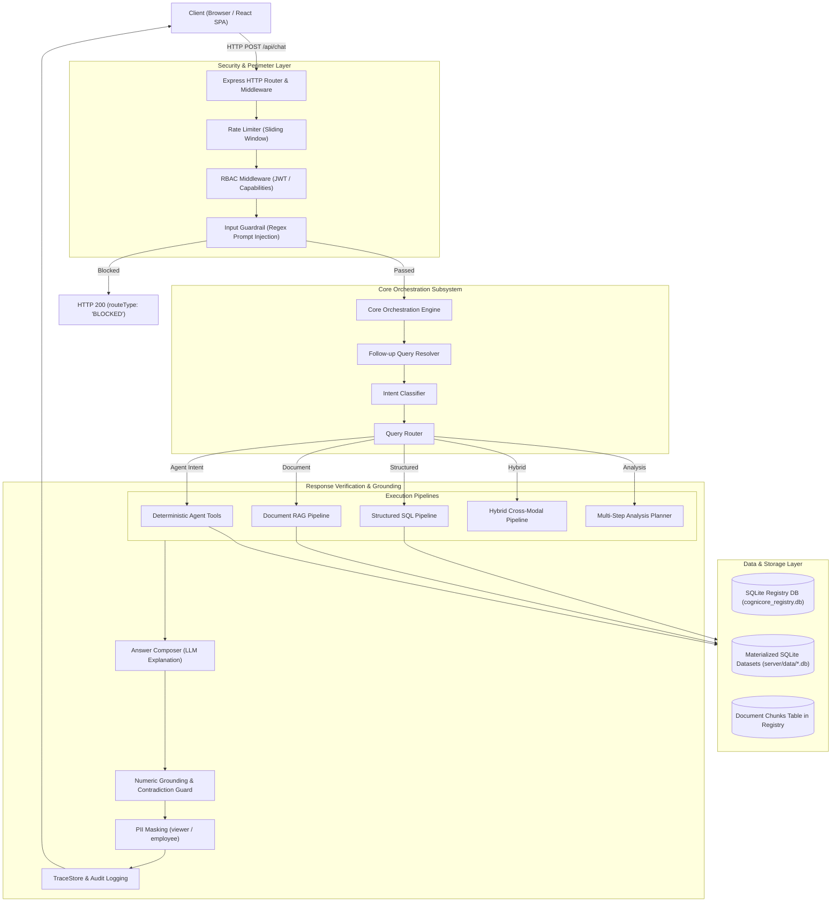
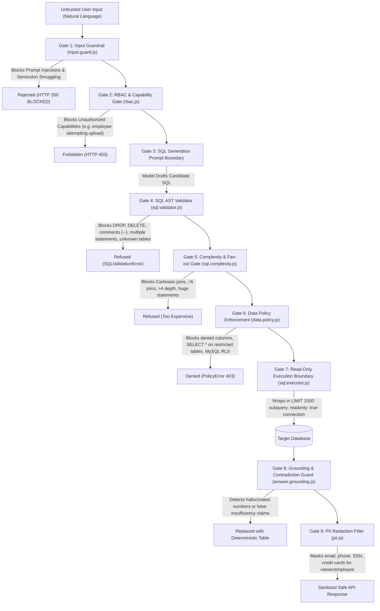
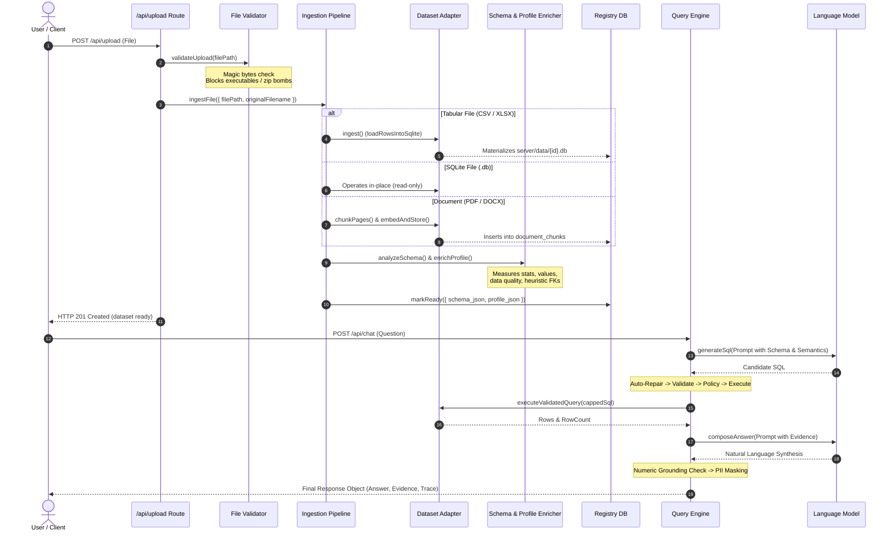

# PART 14 — GLOSSARY & VISUAL DIAGRAMS

This chapter provides a rigorous domain glossary defined directly from the codebase implementation, accompanied by four comprehensive Mermaid architectural diagrams.

---

## 1. Domain Glossary

| Term | Technical Definition from Code | Source Citation |
| :--- | :--- | :--- |
| **`Dataset`** | An identified data source registered in the `datasets` SQLite table, possessing an isolated physical storage location, dynamically discovered schema, and profile. | `server/src/ingestion/dataset.registry.js:26` |
| **`Profile`** | Statistical metadata, column classifications, detected relationships, and data-quality audit scores serialized as JSON in `datasets.profile_json`. | `server/src/schema/schema.analyzer.js:20`, `profile.enricher.js:12` |
| **`Semantic Model`** | Machine-measured column metadata (`role`, `data_type`, `stats`, `values`, `samples`, `description`) built via aggregate SQL queries and attached to prompts. | `server/src/semantic/semantic.builder.js:15-94` |
| **`Evidence`** | A validated, structured JSON payload produced by query execution or document retrieval, acting as the sole source of truth for answer synthesis. | `server/src/evidence/evidence.manager.js:10-56` |
| **`Provenance`** | Verifiable data lineage metadata recording the exact dataset name, database dialect, tables referenced, and row counts returned. | `server/src/evidence/provenance.js:10-25` |
| **`Grounding`** | The deterministic post-synthesis verification ensuring that every numerical token in the model's natural language answer is mathematically traceable to the evidence payload. | `server/src/guardrails/answer.grounding.js:41-55` |
| **`Session State`** | A bounded JSON document stored in `session_state` capturing recent turn history, previous SQL queries, active WHERE filters, and time constraints. | `server/src/core/session.state.js:8-23` |
| **`Action Request`** | A proposed side-effecting operation (email delivery, report export, webhook dispatch) stored in `action_requests` awaiting two-party human approval. | `server/src/actions/action.registry.js:15-28` |
| **`Auto-Repair`** | A suite of six (6) deterministic AST and token transformations applied to candidate SQL before validation without invoking an LLM. | `server/src/core/engines/structured.engine.js:212-241` |
| **`Error Recovery`** | A bounded feedback loop that re-prompts the LLM with previous error messages and unresolved column suggestions when candidate SQL fails validation. | `server/src/core/engines/structured.engine.js:80-130` |

---

## 2. Visual Architecture Diagrams

### Diagram 1: Complete System Architecture
This diagram illustrates the core components, boundaries, and data flows across the CogniCore server.

---

### Diagram 2: Structured Pipeline Detail (All 18 Stages & Loops)
This diagram illustrates the step-by-step execution flow of the structured pipeline, detailing auto-repair, AST validation, and the error recovery loop.

```mermaid
flowchart TD
    Start(["Start: Inbound Query"]) --> S1["1. Input Screening (screenQuestion)"]
    S1 -->|"Blocked"| ExitBlocked["Return BLOCKED"]
    S1 -->|"Passed"| S2["2. Intent Classification (classifyIntent)"]
    S2 --> S3["3. Schema Resolution (dataset.schema)"]
    S3 --> S4["4. Candidate Selection (buildSchemaDescription)"]
    S4 --> S5["5. Few-Shot Pattern Retrieval (selectPatternHints)"]
    S5 --> S6["6. Prompt Assembly (buildPrompt)"]
    S6 --> S7["7. Candidate SQL Generation (LLM Call)"]

    S7 --> RefusalCheck{"Is Response NO_QUERY_POSSIBLE?"}
    RefusalCheck -->|"Yes (First Attempt)"| S7Retry["Single Refusal Retry (retryHint: true)"]
    S7Retry --> S8
    RefusalCheck -->|"No"| S8["8. Deterministic Auto-Repair (prepareSql)"]

    subgraph Repairs ["The 6 Auto-Repairs"]
        S8 --> R1["Repair 1: Table Names"]
        R1 --> R2["Repair 2: Column Names"]
        R2 --> R3["Repair 3: Missing FROM"]
        R3 --> R4["Repair 4: Missing GROUP BY"]
        R4 --> R5["Repair 5: Integer Division (1.0 *)"]
        R5 --> R6["Repair 6: Categorical Value Literals"]
    end

    R6 --> S9["9. SQL AST Validation (node-sql-parser)"]
    S9 --> S10["10. Complexity Gate (Length, Joins, Fan-out)"]

    S10 --> ValidCheck{"Validation Passed?"}
    ValidCheck -->|"Security Violation"| ExitSecurity["Return Validation Failure"]
    ValidCheck -->|"Recoverable Error & Attempt < 2"| S14["14. Error Recovery Loop (generateSql with Hints)"]
    S14 --> S8

    ValidCheck -->|"Passed"| S11["11. Policy Enforcement (CTE Shadowing)"]
    S11 --> S12["12. Read-Only Query Execution (executeValidatedQuery)"]

    S12 --> ExecCheck{"Execution Error?"}
    ExecCheck -->|"Recoverable DB Error"| S14
    ExecCheck -->|"Success"| S13["13. Execution Verification & Empty Diagnosis"]

    S13 --> S15["15. Result Formatting (buildStructuredEvidence)"]
    S15 --> S16["16. Narrative Generation (composeAnswer)"]
    S16 --> GroundingGate{"Passes Numeric Grounding?"}
    GroundingGate -->|"Failed"| DetAnswer["Replace with buildDeterministicAnswer()"]
    GroundingGate -->|"Passed"| S17["17. Audit Logging (TraceStore.save)"]
    DetAnswer --> S17
    S17 --> S18["18. Final Response Assembly (finalize)"]
    S18 --> End(["End: HTTP Response"])
```

---

### Diagram 3: Security Perimeter & Defensive Gates
This diagram highlights where untrusted input encounters deterministic gates and what threats each gate neutralizes.

---

### Diagram 4: Complete Data Lifecycle
This diagram traces an uploaded dataset through ingestion, profiling, storage, query execution, evidence composition, and presentation.

