## 2. Related Work and Theoretical Positioning

```mermaid
flowchart TD
    subgraph PriorWork["Prior Work Paradigm"]
        PW1["User NL Prompt"] --> PW2["Frontier Cloud LLM<br/>(GPT-4 / Claude / 70B+)"]
        PW2 --> PW3["Raw Candidate SQL"]
        PW3 --> PW4["Direct DB Execution<br/>(Check-based or Unconstrained)"]
        PW4 --> PW5["❌ Crash on Hallucinated Cols<br/>❌ Data Leaks Across Tenants<br/>❌ Cartesian Denial-of-Service"]
    end
    subgraph CogniCoreArch["CogniCore Governed Architecture"]
        CC1["User NL Prompt"] --> CC2["Local 7B Model<br/>(Untrusted Compiler)"]
        CC2 --> CC3["Candidate SQL"]
        CC3 --> CC4["Stage 1: Token Auto-Repair"]
        CC4 --> CC5["Stage 2: AST Complexity Gate"]
        CC5 --> CC6["Stage 3: CTE Shadow Policy (RLS)"]
        CC6 --> CC7["Stage 4: Read-Only DB Sandbox"]
        CC7 --> CC8["Stage 5: Feedback Self-Healing"]
        CC8 --> CC9["Stage 6: Numeric Grounding Verifier"]
        CC9 --> CC10["✅ 62.0% EX Accuracy<br/>✅ 0% Data Leakage<br/>✅ 70.6% Crash Reduction"]
    end
```

### 2.1 Text-to-SQL Systems and Benchmarks

The benchmark lineage from Seq2SQL [1] to Spider [2], BIRD [3], and Spider 2.0 [4] has documented a persistent gap between synthetic semantic parsing and production deployment. While frontier systems like DIN-SQL [8], DAIL-SQL [9], CHESS [10], and MAC-SQL [11] focus heavily on multi-agent prompting, prompt organization, and execution feedback, they share a fundamental premise: that the core challenge is *generation quality*. 

However, in enterprise environments, a query can be syntactically valid and semantically aligned with the user prompt, yet catastrophic to execute: it may leak confidential salary records, trigger an unindexed multi-million-row Cartesian join, or aggregate across mismatched fiscal periods. Constrained decoding approaches like PICARD [12] enforce syntactic validity at the token level, but cannot enforce organizational data policies, row-level tenant isolation, or post-synthesis truthfulness.

### 2.2 Governed Semantic Layers: The GROUND Framework

The closest intellectual precursor to our work is GROUND [13], which demonstrated that semantic grounding alone fails to prevent security violations: only explicit enforcement does. GROUND validates queries against seven rule classes and evaluates them on cloud-hosted 70B models. 

CogniCore differs from and extends GROUND in four vital dimensions:
1. **Structural Rewriting vs. Check-Based Detection:** GROUND verifies whether a security predicate exists in the query. As noted in its own threats to validity, check-based approaches can be evaded by adversarial SQL constructs (e.g., subquery nesting, boolean tautologies). CogniCore uses structural Common Table Expression (CTE) shadowing, rewriting table references so that base tables are physically inaccessible outside authorized scopes.
2. **Local Edge Deployment (7B) vs. Cloud Scale (70B+):** GROUND left the viability of small, local models as an explicit open research question. CogniCore proves that local 7B open-weight models, when augmented with deterministic repair and governance, achieve robust enterprise performance.
3. **Deterministic Token-Level Pre-Repair:** Before invoking expensive LLM feedback loops, CogniCore executes six heuristic algorithmic repairs, resolving minor syntax and casing errors in sub-millisecond execution times.
4. **Per-Stage Trace Attribution:** Every execution unit in CogniCore emits structured, millisecond-level telemetry across all pipeline stages, isolating precisely where queries succeed, fail, or recover.

### 2.3 Positioning Matrix

Table 1 summarizes CogniCore's architectural positioning relative to prior literature.

| System / Lineage | Governs Metrics & Joins | Enforces Access Control | Enforcement Mechanism | Failure Attribution | Evaluated Model Scale | Deployment Privacy |
| :--- | :---: | :---: | :---: | :---: | :---: | :---: |
| **Spider / BIRD** [2, 3] | ❌ | ❌ | None | ❌ | Variable Cloud | Cloud API |
| **DIN-SQL / DAIL-SQL** [8, 9] | ❌ | ❌ | None | ❌ | Frontier (GPT-4) | Cloud API |
| **CHESS** [10] | Partial (Schema) | ❌ | None | ❌ | Frontier (GPT-4) | Cloud API |
| **MAC-SQL** [11] | ❌ | ❌ | None | ❌ | GPT-3.5 / 4 | Cloud API |
| **GROUND** [13] | ✅ | ✅ | Check-based (Filter match) | ❌ | 70B Cloud | Cloud API |
| **Governed APIs** [17] | ✅ | ✅ | Rigid Pre-built APIs | ❌ | None (No SQL) | On-Premise |
| **CogniCore (Ours)** | **✅** | **✅** | **Structural (CTE Shadowing)** | **✅ (Per-Stage Traces)** | **7B Local Edge** | **100% Local / Zero Egress** |

---
