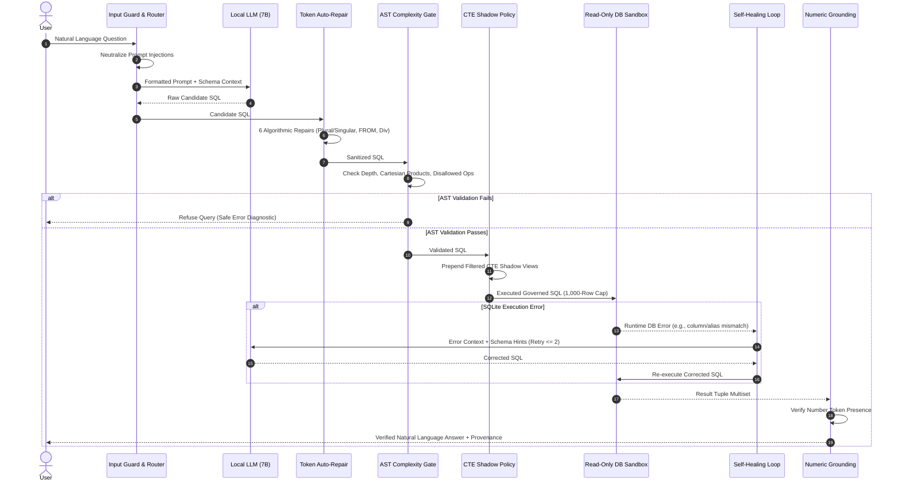

## 3. System Architecture & Threat Model

### 3.1 The Three Core Axioms

The design of CogniCore is anchored upon three operational invariants:
- **Axiom 1 (Truth):** *The LLM is never the source of truth.* Natural language synthesis is strictly conditioned on tabular evidence produced by the query engine. A post-synthesis tokenizer verifies every number in the output prose against the result set; ungrounded numbers or contradictory statements are automatically stripped and replaced with deterministic tabular summaries.
- **Axiom 2 (Arithmetic):** *The LLM never performs arithmetic.* Prompts explicitly prohibit the model from computing sums, averages, percentages, or margins. All calculations are pushed into SQL expressions (`SUM()`, `AVG()`, `CAST(x AS FLOAT) / y`) or deterministic analytical subroutines.
- **Axiom 3 (Authorization):** *The LLM never holds authorization.* The user’s identity, role, and tenant scopes are injected via authenticated session tokens. Security rules are applied downstream from the model, ensuring that prompt manipulations cannot bypass security boundaries.

### 3.2 The Seven-Stage Governed Pipeline

When a natural-language query enters the system, it traverses seven specialized layers:

1. **Input Guard & Semantic Neutralization:** Incoming prompts are screened against known injection patterns (`input.guard.js`). Untrusted document fragments and prompt injections are bounded within `<untrusted_data>` fences.
2. **Deterministic Query Routing:** An intent classifier categorizes requests into structured queries, unstructured document retrieval, analytical reporting, or hybrid execution.
3. **Semantic Schema Enrichment:** Instead of dumping raw, unorganized DDL into the prompt, the schema enricher injects table descriptions, inferred and declared foreign keys, valid categorical values, and authoritative business metric definitions.
4. **Token-Level Algorithmic Auto-Repair:** Candidate SQL from the model passes through six sub-millisecond heuristic repair rules (`sql.repair.js`):
   - Table name inflection (mapping singular guesses to plural tables and vice-versa);
   - Missing `FROM` clause injection for simple projections;
   - Float promotion on integer divisions (e.g., rewriting `a / b` to `100.0 * a / b` to prevent truncated zero integer results);
   - Levenshtein-based column identifier alignment;
   - Missing `GROUP BY` column insertion for mixed aggregate/bare projections;
   - Categorical string literal casing repair against sampled database column profiles.
5. **AST Syntax & Complexity Gating:** Queries are parsed into abstract syntax trees using a strict grammar (`sql.validator.js`). Destructive operations (`DROP`, `DELETE`, `UPDATE`, `INSERT`, `ALTER`, `ATTACH`, `PRAGMA`), chained multiple statements, SQL comment injection delimiters (`--`, `/*`), unkeyed Cartesian products (`FROM a, b` without join predicates), and nested correlated subqueries exceeding safe depth limits are blocked.
6. **Structural Policy Enforcement via CTE Shadowing:** Row-level security (RLS) is applied by rewriting the query. For each table $T$ accessed in the query that is subject to row filter condition $P_T(u)$ for user $u$, the system prepends a Common Table Expression:
   $$\text{WITH } T \text{ AS (SELECT * FROM main.} T \text{ WHERE } P_T(u)\text{)}$$
   Because all subsequent references to $T$ in the user query resolve to the local CTE shadow view rather than the physical table `main.T`, unauthorized rows are isolated at the SQLite execution engine level without fragile predicate surgery.
7. **Execution Sandbox & Monotonic Self-Healing:** The query is wrapped in a 1,000-row cap wrapper:
   $$\text{SELECT * FROM (} \text{CandidateSQL} \text{) AS \_\_cognicore\_capped LIMIT 1000}$$
   and executed against a read-only database handle (`PRAGMA query_only = ON`). If a recoverable runtime error occurs (e.g., alias confusion or non-existent column reference), the error message and relevant schema hints are passed to a bounded reflection loop ($\le 2$ correction attempts) operating at slightly elevated temperature ($0.2$).

---
