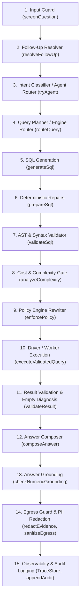
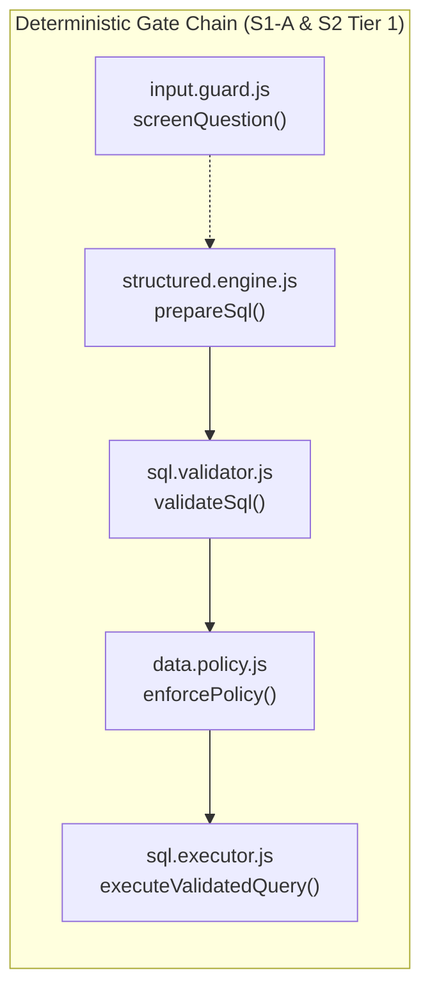
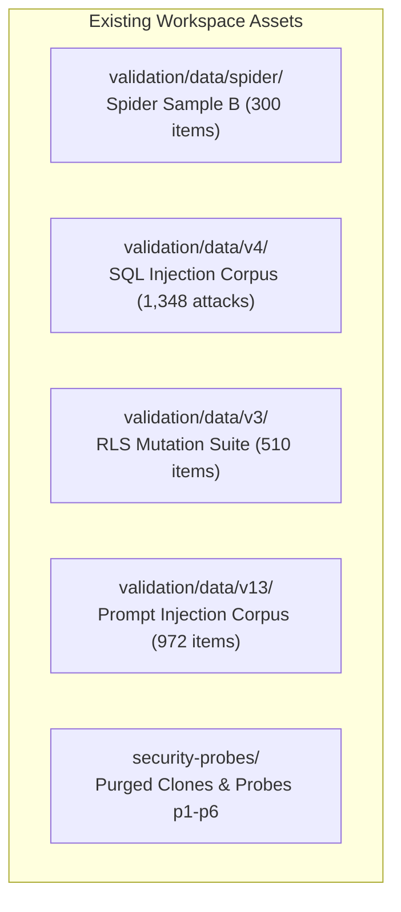

# 00_CODEBASE_GROUNDING.md: CogniCore System & Security Grounding

**Document Status**: Authoritative Grounding Baseline  
**Commit Hash**: `9cde26cc712cd805d48c2ede925393742ec1b68d`  
**Execution Timestamp**: 2026-10-25T14:19:00Z  
**Verification Method**: Static source code audit, direct file inspection, and cross-verification against git commit history. Every statement references explicit `file:line` locations in commit `9cde26cc712cd805d48c2ede925393742ec1b68d`.

---

## Section a: HTTP Routes Required for Security Evaluation Suites (S1 & S2)

Below is the verified routing inventory for all endpoints utilized by S1 (SQL injection & prompt-to-SQL) and S2 (access control enforcement & data leakage). All paths are prefixed under `/api` in `server/src/app.js:33-47`.

| Function / Purpose | Method & Path | Auth & RBAC Middleware | Request Body / Query Format | Response Format & Success Code | Code Receipt (`file:line`) |
| :--- | :--- | :--- | :--- | :--- | :--- |
| **User Registration** | `POST /api/auth/register` | None (Public) | `JSON`: `{"email": string, "password": string, "name"?: string}` | `201 Created`: `{"user": {"user_id": string, "email": string, "name": string, "role": string}, "token": string}` | `server/src/api/routes/auth.js:21-45` |
| **User Login** | `POST /api/auth/login` | None (Public, Rate-locked) | `JSON`: `{"email": string, "password": string}` | `200 OK`: `{"user": {...}, "token": string}` | `server/src/api/routes/auth.js:48-91` |
| **List Users** | `GET /api/admin/users` | `requireAuth`, `requireRole('admin')` | None | `200 OK`: `{"users": [{"user_id", "email", "name", "role", "created_at"}, ...]}` | `server/src/api/routes/admin.js:10-12` |
| **Role Assignment** | `PATCH /api/admin/users/:id/role` | `requireAuth`, `requireRole('admin')` | `JSON`: `{"role": string}` (`admin`, `manager`, `analyst`, `user`, `employee`, `viewer`) | `200 OK`: `{"user": {...}}` | `server/src/api/routes/admin.js:15-26` |
| **Dataset Ingestion (File)** | `POST /api/upload` | `requireAuth`, `requireCapability('upload')` | `multipart/form-data`: field `file` (`.sqlite`, `.db`, `.csv`, `.xlsx`, `.json`) | `201 Created`: `{"dataset": {"dataset_id", "name", "type", "status", "schema", ...}}` | `server/src/api/routes/upload.js:31-64` |
| **Dataset Ingestion (RDBMS)** | `POST /api/connections` | `requireAuth`, `requireCapability('connect')` | `JSON`: `{"type": "postgres"|"mysql", "name"?: string, "host", "port"?, "database", "user", "password", "ssl"?: boolean}` | `201 Created`: `{"dataset": {...}}` (credentials omitted) | `server/src/api/routes/connections.js:11-34` |
| **Dataset Sharing** | `POST /api/datasets/:id/share` | `requireAuth`, `requireDatasetAccess('manage')` | `JSON`: `{"email": string, "permission": "read"|"manage"}` | `200 OK`: `{"success": true}` | `server/src/api/routes/datasets.js:70-85` |
| **Revoke Dataset Access** | `DELETE /api/datasets/:id/share/:userId`| `requireAuth`, `requireDatasetAccess('manage')` | URL params | `200 OK`: `{"success": true}` | `server/src/api/routes/datasets.js:88-95` |
| **List Dataset Shares** | `GET /api/datasets/:id/shares` | `requireAuth`, `requireDatasetAccess('manage')` | URL params | `200 OK`: `{"shares": [{"grant_id", "dataset_id", "user_id", "permission", "email"}, ...]}` | `server/src/api/routes/datasets.js:98-101` |
| **List Policies** | `GET /api/policies/:datasetId` | `requireAuth`, `requireCapability('policy.manage')`, `requireDatasetAccess('manage')` | URL params | `200 OK`: `{"policies": [...], "roles": ["*", "manager", "analyst", "user", "employee", "viewer"]}` | `server/src/api/routes/policies.js:12-14` |
| **Create Policy** | `POST /api/policies/:datasetId` | `requireAuth`, `requireCapability('policy.manage')`, `requireDatasetAccess('manage')` | `JSON`: `{"role": string, "kind": "deny_column"|"row_filter", "columnName": string, "tableName"?: string, "op"?: "="|"!="| "IN", "value"?: string}` | `201 Created`: `{"policyId": string}` | `server/src/api/routes/policies.js:17-30` |
| **Delete Policy** | `DELETE /api/policies/:datasetId/:policyId` | `requireAuth`, `requireCapability('policy.manage')`, `requireDatasetAccess('manage')` | URL params | `200 OK`: `{"ok": true}` | `server/src/api/routes/policies.js:33-40` |
| **Dataset Schema** | `GET /api/schema/:datasetId` | `requireAuth`, `requireDatasetAccess('read')` | URL params | `200 OK`: `{"datasetId", "isDocument": false, "tables": [{"name", "columns": [...], "rowCount"}], ...}` | `server/src/api/routes/schema.js:10-27` |
| **Dataset Preview** | `GET /api/datasets/:id/preview` | `requireAuth`, `requireDatasetAccess('read')` | Query: `?table=name&limit=10` | `200 OK`: `{"table": string, "columns": [...], "rows": [...], "rowCount": number}` (egress-sanitized) | `server/src/api/routes/datasets.js:42-67` |
| **Chat / Natural Language Query**| `POST /api/chat` | `requireAuth`, `requireCapability('query')`, `rateLimit(30/min)` | `JSON`: `{"question": string, "datasetId"?: string, "datasetIds"?: string[], "sessionId"?: string, "analysisMode"?: boolean}` | `200 OK`: `{"sessionId", "routeType", "answer", "evidence", "generatedSql", "execResult"?, "trace", ...}` | `server/src/api/routes/chat.js:12-58` |
| **Observability Traces** | `GET /api/traces` & `GET /api/traces/:id` | `requireAuth` (Admins can view `?scope=all`) | Query `?limit=40&scope=all` or `:id` | `200 OK`: `{"traces": [...]}` or `{"trace": {"trace_id", "question", "steps": [{"name", "status", "detail", "ms"}], ...}}` | `server/src/api/routes/traces.js:9-20` |
| **Data Export (CSV/XLSX)** | `POST /api/tools/export` | `requireAuth`, `requireCapability('export')`, `requireDatasetAccess('read')` | `JSON`: `{"sql": string, "format": "csv"|"xlsx", "filename"?: string}` (with header `dataset-id` or body `datasetId`) | `200 OK`: Binary stream (`text/csv` or `application/vnd.openxmlformats-...`) | `server/src/api/routes/tools.js:38-60` |
| **PDF Report Tool** | `POST /api/tools/report` | `requireAuth`, `requireCapability('export')`, `requireDatasetAccess('read')` | `JSON`: `{"sql": string, "question"?: string, "answer"?: string, "title"?: string}` | `200 OK`: Binary stream (`application/pdf`) | `server/src/api/routes/tools.js:63-83` |
| **Chart Tool** | `POST /api/tools/chart` | `requireAuth`, `requireCapability('chart')`, `requireDatasetAccess('read')` | `JSON`: `{"sql": string, "chartType": string, "xField": string, "yFields": string[], "title"?: string}` | `200 OK`: `{"chart": {...}, "rowCount": number, "truncated": boolean}` | `server/src/api/routes/tools.js:21-27` |
| **Admin Audit Log** | `GET /api/admin/audit` | `requireAuth`, `requireRole('admin')` | Query: `?userId=&resourceId=&limit=100` | `200 OK`: `{"entries": [{"audit_id", "user_id", "action", "resource_type", "resource_id", "success", "details", "created_at"}, ...]}` | `server/src/api/routes/admin.js:29-37` |

---

## Section b: Pipeline Stage Order

When a query is dispatched via `handleUserQuery` (`server/src/core/core.engine.js:48`), execution strictly traverses the following sequence:



1. **Stage 1: Input Guard** (`server/src/guardrails/input.guard.js:37`):  
   Invoked in `core.engine.js:58`. Evaluates `screenQuestion(question)`. Screens against 14 static regexes for prompt injection and length cap (> 4,000 characters). Flags SQL injection attempts (`SQLI_LIKE`), but critically **does not block** on SQLI patterns alone (`core.engine.js:60-66`, `input.guard.js:43`).
2. **Stage 2: Follow-up Resolver** (`server/src/core/followup.resolver.js:70`):  
   Invoked in `core.engine.js:77`. Rewrites conversational follow-up questions using session conversation state and the `rewrite` LLM provider.
3. **Stage 3: Intent Classifier & Agent Router** (`server/src/agent/agent.js:15`):  
   Invoked in `core.engine.js:90`. Fast regex and keyword intent classifier (`ANALYTIC_INTENTS`). If matched (`overview`, `describe`, `kpi`, etc.), routes to specialized deterministic analytical tools.
4. **Stage 4: Query Planner / Engine Router** (`server/src/core/query.router.js:20`):  
   Invoked in `core.engine.js:109`. Determines engine target: `STRUCTURED` (`structured.engine.js`), `DOCUMENT` (`document.engine.js`), `HYBRID` (`hybrid.engine.js`), or `ANALYSIS` (`analysis.engine.js`).
5. **Stage 5: SQL Generation** (`server/src/structured/sql.generator.js:70`):  
   Invoked in `structured.engine.js:46`. Builds prompt containing schema DDL, foreign keys, semantic meanings, and business rules; calls `sql` LLM provider (`ollama:qwen2.5:14b`) at `temperature: 0.1` (`temperature: 0.2` on retry).
6. **Stage 6: Deterministic Repair Loop** (`server/src/core/engines/structured.engine.js:148`):  
   Invoked in `structured.engine.js:63`. Runs `prepareSql(rawSql)`. Sequentially executes:
   - `repairTableNames` (`server/src/structured/sql.repair.js:12`)
   - `repairColumnNames` (`server/src/structured/sql.analyzer.js:78`)
   - `ensureFromClause` (`server/src/structured/sql.repair.js:52`)
   - `repairMissingGroupBy` (`server/src/structured/sql.analyzer.js:115`)
   - `fixIntegerDivision` (`server/src/structured/sql.repair.js:83`)
   - `repairValueLiterals` (`server/src/structured/sql.values.repair.js:12`)
7. **Stage 7: AST & Safety Validator** (`server/src/structured/sql.validator.js:192`):  
   Invoked in `structured.engine.js:66`. Parses SQL via `node-sql-parser`. Enforces single-statement `SELECT`, inspects string literals for injection smuggling (`inspectLiterals:36`), blocks prohibited DDL/DML keywords, detects unauthorized diagnostic functions, checks nested subquery depth, and verifies tables against schema allowlist.
8. **Stage 8: Complexity & Cost Gate** (`server/src/structured/sql.complexity.js:24`):  
   Invoked synchronously inside `sql.validator.js:337`. Analyzes character length (limit 4,000), join count (limit 6), subquery nesting depth (limit 4), unkeyed Cartesian comma joins, constant-true `ON` clauses, and estimated fan-out (> 5e9 rows).
9. **Stage 9: Policy Engine Rewriter** (`server/src/security/data.policy.js:387`):  
   Invoked in `structured.engine.js:79`. Runs `enforcePolicy({ sql, schema, policy, datasetType })`:
   - `assertColumnAccess`: Scans AST tokens for references to `deniedColumns` directly, via aliases, CTE lineage, or wildcard `*`. Throws fatal `PolicyError (403)` if found (`data.policy.js:71-210`).
   - `applyRowFilters`: Normalizes schema qualifiers (`normalizeTableReferences:303`), then shadows target tables with Common Table Expressions (`WITH "table" AS (SELECT * FROM ... WHERE ...)`). Fails closed on MySQL (`data.policy.js:348`).
10. **Stage 10: Database Execution / Worker Thread** (`server/src/structured/sql.executor.js:75`):  
    Invoked in `structured.engine.js:90`. Dispatches `executeValidatedQuery(adapter, execSql)`:
    - Wraps query in `enforceLimit(sql, maxRows)` (`sql.executor.js:174`).
    - For SQLite: Offloads execution to isolated Node.js worker thread (`server/src/structured/sqlite.worker.js:10`) running under `readonly: true` and `PRAGMA query_only = ON`. Aborted via `worker.terminate()` if execution exceeds `timeoutMs` (15,000ms).
    - For Postgres/MySQL: Dispatches to pool connection with asynchronous timeout racing (`sql.executor.js:90-145`).
11. **Stage 11: Result Validation & Empty Result Diagnosis** (`server/src/structured/result.validator.js:10`, `server/src/structured/result.checks.js:15`):  
    Invoked in `structured.engine.js:100-118`. Performs structural checks (null bounds, column types) and semantic sanity checks. If zero rows returned, triggers `diagnoseEmptyResult` to inspect column value distributions.
12. **Stage 12: Answer Composer** (`server/src/response/answer.composer.js:20`):  
    Invoked in `core.engine.js:132`. Formats evidence rows into Markdown tables and prompts the `reasoning` LLM (`temperature: 0.3`) to write a concise analytical summary.
13. **Stage 13: Answer Grounding Check** (`server/src/guardrails/answer.grounding.js:46`):  
    Invoked in `core.engine.js:135` (`applyGrounding`). Scans every number in the LLM-generated prose against evidence numbers (`evidenceNumbers:10`). If an ungrounded hallucination or contradiction is detected, discards the LLM text and substitutes a deterministic template answer (`buildDeterministicAnswer:120`).
14. **Stage 14: Egress Guard & PII Redaction** (`server/src/security/egress.guard.js:20`, `server/src/guardrails/pii.js:63`):  
    Invoked in `core.engine.js:292-325`. Redacts semantic PII columns for low-privilege roles (`viewer`, `employee`), runs regex masking on response text (`maskText`), and scrubs `execResult` rows/columns through `sanitizeEgress`.
15. **Stage 15: Observability & Audit Logging** (`server/src/observability/trace.js:35`, `server/src/security/auth.registry.js:145`):  
    Invoked in `core.engine.js:313-328` and `server/src/api/routes/chat.js:46`. Appends detailed step-by-step trace timings to `TraceStore` and writes persistent security audit rows to `cognicore_registry.db`.

---

## Section c: Standalone Invocation Analysis for Non-LLM Stages

The evaluation suites (S1-A and S2 Tier 1) require calling pipeline components directly in plain Node.js without instantiating or invoking Ollama.



### 1. `screenQuestion`
- **Source**: `server/src/guardrails/input.guard.js:37-49`
- **Exact Signature**: `function screenQuestion(question: string): { blocked: boolean, flags: string[], message: string|null }`
- **Inputs**: `question` (string).
- **Outputs**: Plain object with boolean `blocked`, string array `flags` (`prompt_injection`, `sql_injection_attempt`, `oversized_input`), and string `message`.
- **Side Effects**: None. Pure deterministic regex matcher.
- **Required Config / Handles**: None. Zero external dependencies.
- **Standalone Importable**: **YES**. Directly importable via `require('./server/src/guardrails/input.guard')`.

### 2. `prepareSql`
- **Source**: `server/src/core/engines/structured.engine.js:148-175`
- **Exact Signature**: `function prepareSql(rawSql: string, context: { schema: object, semantic?: object, datasetType: string }): { sql: string, repairs: Array<{type: string, ...}>, unresolvedColumns?: string[] }`
- **Inputs**: `rawSql` (string), schema descriptor (`{ tables: [...] }`), optional semantic catalog, `datasetType` (`'sqlite'` | `'postgres'` | `'mysql'`).
- **Outputs**: Repaired SQL string, structured list of applied repair actions, unresolved column names.
- **Side Effects**: None. In-memory string manipulation and token AST repair.
- **Required Config / Handles**: Schema object. No live database connection needed.
- **Standalone Importable**: **YES**. Exported in `structured.engine.js:183`.

### 3. `validateSql`
- **Source**: `server/src/structured/sql.validator.js:192-342`
- **Exact Signature**: `function validateSql(sql: string, schema: object, dialect?: string): { valid: boolean, ast: object, tablesUsed: string[], complexity: object }`
- **Inputs**: `sql` (string), `schema` object (`{ tables: [{ name: string, columns: [{ name: string }] }] }`), optional `dialect` (`'sqlite'` default, `'postgresql'`, `'mysql'`).
- **Outputs**: Returns `{ valid: true, ast, tablesUsed, complexity }` or throws `SQLValidationError`.
- **Side Effects**: Emits logger warnings via Winston logger (`server/src/config/logger.js`) if unknown columns are encountered.
- **Required Config / Handles**: Schema descriptor. No database connection required.
- **Standalone Importable**: **YES**. Directly importable via `require('./server/src/structured/sql.validator')`.

### 4. `enforcePolicy`
- **Source**: `server/src/security/data.policy.js:387-390`
- **Exact Signature**: `function enforcePolicy({ sql: string, schema: object, policy: object, datasetType: string }): string`
- **Inputs**: `sql` (string), `schema` object, `policy` descriptor (`{ deniedColumns: [{table, column}], rowFilters: [{table, column, op, value}] }`), `datasetType` string.
- **Outputs**: Rewritten SQL string containing shadow CTEs, or throws `PolicyError` (HTTP 403).
- **Side Effects**: None. Pure string/AST transformation.
- **Required Config / Handles**: Schema and policy objects. Does **not** require database handle when invoked directly (bypassing `resolvePolicy`).
- **Standalone Importable**: **YES**. Directly importable via `require('./server/src/security/data.policy')`.

### 5. `executeValidatedQuery`
- **Source**: `server/src/structured/sql.executor.js:75-171`
- **Exact Signature**: `async function executeValidatedQuery(adapter: object, sql: string, options?: { maxRows?: number, timeoutMs?: number }): Promise<{ columns: string[], rows: object[], rowCount: number, truncated: boolean, durationMs: number, sqlExecuted: string }>`
- **Inputs**: Connected `DataSourceAdapter` instance (e.g. `SQLiteAdapter`), validated `sql` string, options (`maxRows`, `timeoutMs`).
- **Outputs**: Resolves query result set or throws execution error / timeout rejection.
- **Side Effects**: Executes read-only query against the underlying database. For SQLite, spawns an isolated worker thread (`sqlite.worker.js`).
- **Required Config / Handles**: Requires instantiated and connected adapter (`adapter.connect()`), or valid database file path for SQLite.
- **Standalone Importable**: **YES**. Directly importable via `require('./server/src/structured/sql.executor')`.

---

## Section d: Policy Engine Specifications

CogniCore’s data access governance is implemented in `server/src/security/data.policy.js:1-391`.

### 1. Storage & Schema
Policies are persisted in the central registry SQLite database (`cognicore_registry.db`) in table `data_policies`:
```sql
CREATE TABLE IF NOT EXISTS data_policies (
  policy_id TEXT PRIMARY KEY,
  dataset_id TEXT NOT NULL,
  role TEXT NOT NULL,            -- admin | manager | analyst | employee | viewer | user | *
  kind TEXT NOT NULL,            -- deny_column | row_filter
  table_name TEXT,               -- optional: restrict to one table
  column_name TEXT NOT NULL,
  op TEXT,                       -- = | != | IN   (row_filter)
  value TEXT,                    -- literal or {{user.*}} template (row_filter)
  created_by TEXT,
  created_at TEXT NOT NULL
);
CREATE INDEX IF NOT EXISTS idx_policy_dataset ON data_policies(dataset_id);
```
Managed via `PolicyStore.add`, `PolicyStore.list`, `PolicyStore.remove`, and `PolicyStore.removeForDataset` (`data.policy.js:36-50`).

### 2. Supported Policy Constructs
- **`deny_column`**: Restricts the designated role from referencing the column anywhere in the SQL statement.
- **`row_filter`**: Restricts visible rows by evaluating `<column> <op> <value>` where `op` $\in \{=, \ne, \text{IN}\}$.
- **Table Denial**: **Not a native policy kind**. Attempting to add `kind: 'deny_table'` throws an exception (`data.policy.js:37`). Table access control must be achieved either by denying all constituent columns or withholding dataset access grants in `auth_grants`.
- **Column Masking**: **Not implemented at the data policy layer**. `data.policy.js:37` strictly permits only `deny_column` and `row_filter`. Masking occurs only at the egress presentation boundary (`pii.js:38`).

### 3. User-Attribute Templating
In `resolvePolicy` (`data.policy.js:52-61`), row filter values support moustache templates:
- `{{user.email}}`
- `{{user.user_id}}`
- `{{user.name}}`
- `{{user.role}}`  
Values are resolved at runtime against the active session user before SQL rewriting.

### 4. Enforcement Mechanics & Behavior on Violation
- **Column Denial Handling**: Handled via `assertColumnAccess` (`data.policy.js:71-210`). It **REJECTS** the query by throwing `PolicyError (403)`. It does **not** mask, replace with NULL, or silently filter columns.
  - References via projection (`SELECT col FROM t`) $\rightarrow$ Throws `PolicyError`.
  - References in predicates (`WHERE col > 0`) $\rightarrow$ Throws `PolicyError`.
  - References in grouping/ordering (`GROUP BY col`, `ORDER BY col`) $\rightarrow$ Throws `PolicyError`.
  - References inside subqueries or CTE lineage $\rightarrow$ Throws `PolicyError`.
  - Wildcard expansion (`SELECT * FROM t` or `SELECT t.*`) when table contains denied columns $\rightarrow$ Throws `PolicyError` ("Your role cannot access the restricted column(s)... Ask for specific columns instead of all columns").
- **Row Filter Handling**: Handled via `applyRowFilters` (`data.policy.js:321-384`). Normalizes schema-qualified tables (`normalizeTableReferences:303`), then shadows target tables with Common Table Expressions:
  ```sql
  WITH "customers" AS (
    SELECT * FROM main."customers" WHERE "region" = 'EMEA'
  )
  SELECT "customer_id", "name" FROM "customers";
  ```
- **Dialect Support & Fail-Closed Invariants**:
  - **SQLite**: Supported. Prepends CTE; qualifies physical source as `main."table"`.
  - **PostgreSQL**: Supported. Prepends CTE; qualifies physical source as `"public"."table"`.
  - **MySQL**: **Fails closed**. Throws `PolicyError: Row-level restrictions are not supported on MySQL connections; access denied to protect restricted rows` (`data.policy.js:348`).
  - **System Catalogs**: System catalog tables (`sqlite_master`, `sqlite_schema`, `sqlite_temp_master`) throw `PolicyError` unconditionally (`data.policy.js:296-300`).

---

## Section e: Connection & Execution Isolation Modes

Execution boundaries differ significantly by database engine:

### 1. SQLite (`server/src/ingestion/adapters/sqlite.adapter.js` & `server/src/structured/sqlite.worker.js`)
- **Connection Flags**: `new Database(this.location, { readonly: true, fileMustExist: true })` (`sqlite.adapter.js:16`, `sqlite.worker.js:10`).
- **Engine PRAGMA**: `db.pragma('query_only = ON')` (`sqlite.adapter.js:17`, `sqlite.worker.js:12`).
- **Thread Isolation**: `executeSqliteInWorker` (`sql.executor.js:18-69`) runs queries in an isolated `node:worker_threads` thread.
- **Timeout Termination**: If execution exceeds `timeoutMs` (default 15,000ms), `worker.terminate()` is called synchronously, killing the thread and preventing event loop starvation (`sql.executor.js:46-51`).
- **Row Cap**: Enforced by wrapping the statement in `SELECT * FROM (<query>) AS __cognicore_capped LIMIT <maxRows>` (`sql.executor.js:174`).

### 2. PostgreSQL (`server/src/ingestion/adapters/postgres.adapter.js`)
- **Connection Pooling**: `pg.Pool` with connection pool size capped at 3 (`postgres.adapter.js:23`).
- **Read-Only Enforcement**: **None at driver layer**. `executeQuery` executes `this.pool.query(sql)` directly (`postgres.adapter.js:131`). It does **not** execute `SET TRANSACTION READ ONLY`. Isolation relies entirely on `sql.validator.js`.
- **Timeout**: Enforced via JavaScript `Promise.race` timeout (`sql.executor.js:140-146`). Note: Terminating the client promise does not cancel long-running queries inside PostgreSQL unless `statement_timeout` is configured on the backend.

### 3. MySQL (`server/src/ingestion/adapters/mysql.adapter.js`)
- **Connection Pooling**: `mysql2/promise.createPool` with max 3 connections (`mysql.adapter.js:13`).
- **Read-Only Enforcement**: **None at driver layer**. `executeQuery` calls `this.pool.query(sql)` directly (`mysql.adapter.js:115`).
- **Timeout Handling**: Uses active thread kill. On timeout expiration, grabs a connection and executes `KILL QUERY ${threadId}` (`sql.executor.js:108-115`).

---

## Section f: Layer-Toggle Architecture & Disable Points

To measure the attack funnel ($L_1 \rightarrow L_2 \rightarrow L_3$) and attribute first-stop rejections, the evaluation harness must be able to selectively bypass individual defense layers.

### 1. Existing Environment Toggles

| Variable | Target File:Line | Default | Effect When Toggled |
| :--- | :--- | :--- | :--- |
| `ENFORCE_COLUMN_VALIDATION` | `sql.validator.js:321` | `'false'` (shadow) | If `'true'`, unknown columns reject query; if `'false'`, logs warning and permits. |
| `PII_MASK_ROLES` | `pii.js:8` | `'viewer,employee'` | Comma-separated list of roles subjected to egress regex scrubbing. |
| `SQL_MAX_LENGTH` | `sql.complexity.js:14` | `4000` | Max character length for SQL statement before rejection. |
| `SQL_MAX_JOINS` | `sql.complexity.js:15` | `6` | Max permitted join count before complexity rejection. |
| `SQL_MAX_SUBQUERY_DEPTH` | `sql.complexity.js:16` | `4` | Max nesting level of subqueries. |
| `SQL_MAX_ESTIMATED_ROWS` | `sql.complexity.js:17` | `5e9` | Max Cartesian row estimation ceiling. |
| `MAX_RESULT_ROWS` | `env.js:40` | `1000` | Outer wrapper row limit cap. |
| `QUERY_TIMEOUT_MS` | `env.js:41` | `15000` | Millisecond execution timeout ceiling. |
| `CHAT_RATE_LIMIT_PER_MIN` | `rate.limit.js:7` | `30` | In-memory IP/user rate limiter bucket size. |

### 2. Missing Disable Points (Required Toggles for Research Harness)
The codebase currently lacks environment variables to toggle core security gates. To evaluate layers independently without dirtying the working tree, the following toggle mechanisms must be designed and documented in `CODE_DELTAS.md`:

1. **Input Guard Bypass**:
   - *Target*: `server/src/core/core.engine.js:58-66`
   - *Design*: Check `process.env.SECURITY_EVAL_DISABLE_INPUT_GUARD === 'true'`. If enabled, skip `screenQuestion` and proceed directly to follow-up resolution.
2. **SQL Auto-Repair Bypass**:
   - *Target*: `server/src/core/engines/structured.engine.js:63-65`
   - *Design*: Check `process.env.SECURITY_EVAL_DISABLE_REPAIR === 'true'`. If enabled, bypass `prepareSql` and pass raw generated SQL directly to the validator.
3. **AST Safety Validator Bypass**:
   - *Target*: `server/src/core/engines/structured.engine.js:66-77`
   - *Design*: Check `process.env.SECURITY_EVAL_DISABLE_VALIDATOR === 'true'`. If enabled, skip `validateSql` and pass prepared SQL directly to policy enforcement.
4. **Complexity Gate Bypass**:
   - *Target*: `server/src/structured/sql.validator.js:337`
   - *Design*: Check `process.env.SECURITY_EVAL_DISABLE_COMPLEXITY === 'true'`. If enabled, skip `analyzeComplexity`.
5. **Data Policy Rewriter Bypass**:
   - *Target*: `server/src/core/engines/structured.engine.js:79-84`
   - *Design*: Check `process.env.SECURITY_EVAL_DISABLE_POLICY === 'true'`. If enabled, skip `enforcePolicy` and execute raw SQL without column denial checks or CTE shadowing.
6. **Driver Read-Only Bypass (Deliberately Naive Connection for Oracle Testing)**:
   - *Target*: `server/src/ingestion/adapters/sqlite.adapter.js:10-18` & `server/src/structured/sqlite.worker.js:10-12`
   - *Design*: Add a flag or separate testing connection harness that opens SQLite with `readonly: false` and omits `PRAGMA query_only = ON` to verify whether mutating payloads accepted by earlier gates actually execute writes.

---

## Section g: Comprehensive Leak Surface Inventory

Every output channel of the application where sensitive data, denied column values, or query fragments could escape must be monitored:

| Leak Surface ID | Surface Name | Emitting Route / Channel | Sanitization Mechanism in Code | Residual Exposure / Leak Risk | Code Receipt (`file:line`) |
| :---: | :--- | :--- | :--- | :--- | :--- |
| **S-01** | **Answer Prose** | `POST /api/chat` (`answer`) | `maskText()` applied only if `redacted > 0` or role is `viewer`/`employee`. | If role is `analyst` or `user`, unredacted data is returned in natural language prose unless matched by generic regex. | `core.engine.js:296`, `pii.js:46-60` |
| **S-02** | **Evidence Sample Rows** | `POST /api/chat` (`evidence.sample_rows`) | `redactEvidence()` masks semantic PII columns for `viewer`/`employee`. | If a query bypasses policy rewriter or queries unflagged sensitive columns, raw data rows are exposed in `evidence.sample_rows`. | `core.engine.js:292-294`, `pii.js:63-84` |
| **S-03** | **Execution Result** | `POST /api/chat` (`execResult`) | `sanitizeEgress()` filters denied columns and rows. | Admins bypass unconditionally (`egress.guard.js:20`). Malformed column case or alias mismatches could leak rows. | `core.engine.js:321-325`, `egress.guard.js:16-85` |
| **S-04** | **Generated SQL** | `POST /api/chat` (`generatedSql`) | None. Raw generated SQL string is returned directly. | Leaks sensitive literal values injected into `WHERE` clauses (e.g. `WHERE password = 'secret'`). | `core.engine.js:320`, `chat.js:57` |
| **S-05** | **Chart Specifications** | `POST /api/chat` (`chart`), `POST /api/tools/chart` | Inherits evidence rows; `resolveValidatedResult` runs `sanitizeEgress`. | Data points plotted in SVG/Vega charts expose numeric data from denied columns if query was accepted. | `analytics/viz.js:300`, `tools.js:21-27` |
| **S-06** | **File Exports (CSV/XLSX)**| `POST /api/tools/export`, `/export-analysis` | `resolveValidatedResult` calls `sanitizeEgress`. | If `sanitizeEgress` has table matching gaps on joined views, raw CSV rows leak sensitive fields. | `tools.js:38-60`, `analytics.js:131-143` |
| **S-07** | **PDF Reports** | `POST /api/tools/report` | Rendered via PDFKit from `result.rows` post-sanitization. | Leaks data if un-sanitized results reach `buildPdfReport`. | `tools.js:63-83` |
| **S-08** | **Observability Traces** | `GET /api/traces/:id` | None. Stores raw step details, generated SQL, and execution timings. | Traces contain verbatim raw SQL and error messages (`trace.add('sql_generated', ..., rawSql)`). Admins view all traces. | `traces.js:16-19`, `structured.engine.js:52`, `trace.js:1-55` |
| **S-09** | **Audit Log** | `GET /api/admin/audit` | Truncated details JSON. | Stores generated SQL query text and table names in plaintext in `cognicore_registry.db`. | `chat.js:46-56`, `admin.js:29-37` |
| **S-10** | **Error Messages** | HTTP 400/500 JSON bodies | Standard `errorHandler`. Masks stack trace in production. | `err.message` reflects verbatim SQLite/Postgres syntax errors, which may reveal internal column names, table names, or failed literal checks. | `server/src/api/middleware/errorHandler.js:1-25` |
| **S-11** | **Server Logs** | Console / Winston stdout stream | None. | Debug and warning logs print SQL tokens, unknown column warnings, and failed injection details to stdout. | `logger.js:1-40`, `sql.validator.js:322` |

---

## Section h: LLM Settings & Hyperparameters

CogniCore interfaces with local open-weight models via Ollama (`server/src/llm/ollama.provider.js:1-55`). The model routing is configured in `server/src/llm/model.manager.js:1-68`.

| Parameter | Configuration Key / Env Var | Code Default Value | Configurable vs Hardcoded | Invocation Context (`file:line`) |
| :--- | :--- | :--- | :--- | :--- |
| **Provider** | `LLM_PROVIDER` | `'ollama'` | Configurable via env | `server/src/config/env.js:23` |
| **Base URL** | `OLLAMA_BASE_URL` | `'http://localhost:11434'` | Configurable via env | `server/src/config/env.js:25` |
| **Default Model** | `OLLAMA_MODEL` | `'qwen2.5:14b'` | Configurable via env | `server/src/config/env.js:26` |
| **SQL Model** | `OLLAMA_MODEL_SQL` | `config.llm.ollama.model` | Configurable via env | `server/src/llm/model.manager.js:28` |
| **Reasoning Model** | `OLLAMA_MODEL_REASONING` | `config.llm.ollama.model` | Configurable via env | `server/src/llm/model.manager.js:28` |
| **Rewrite Model** | `OLLAMA_MODEL_REWRITE` | `config.llm.ollama.model` | Configurable via env | `server/src/llm/model.manager.js:28` |
| **Planner Model** | `OLLAMA_MODEL_PLANNER` | `config.llm.ollama.model` | Configurable via env | `server/src/llm/model.manager.js:28` |
| **Timeout (ms)** | `OLLAMA_TIMEOUT_MS` | `120000` (120 seconds) | Configurable via env | `server/src/config/env.js:27` |
| **Embedding Model**| `OLLAMA_EMBEDDING_MODEL` | `'nomic-embed-text'` | Configurable via env | `server/src/config/env.js:28` |
| **Temperature (SQL)**| None | `0.1` (`0.2` on retry) | **Hardcoded** | `server/src/structured/sql.generator.js:119` |
| **Temperature (Reasoning)**| None | `0.3` | **Hardcoded** | `server/src/response/answer.composer.js:73` |
| **Temperature (Rewrite)**| None | `0` | **Hardcoded** | `server/src/core/followup.resolver.js:82` |
| **Temperature (Plan)**| None | `0.2` | **Hardcoded** | `server/src/core/engines/analysis.engine.js:36` |
| **Max Tokens (SQL)**| None | `500` | **Hardcoded** | `server/src/structured/sql.generator.js:119` |
| **Max Tokens (Reasoning)**| None | `500` | **Hardcoded** | `server/src/response/answer.composer.js:73` |
| **Max Tokens (Rewrite)**| None | `120` | **Hardcoded** | `server/src/core/followup.resolver.js:82` |
| **Context Size (`num_ctx`)**| None | *Ollama Default* (omitted from payload) | **Unset in request** | `server/src/llm/ollama.provider.js:29-37` |
| **Retry Limits** | `MAX_RECOVERY_ATTEMPTS` | `2` iterations (+1 give-up retry) | **Hardcoded** | `server/src/core/engines/structured.engine.js:20, 56` |

---

## Section i: Existing Evaluation Assets & Reusable Artifacts

The repository already houses several test corpora, validation harnesses, benchmark results, and database fixtures:



### 1. SQL Injection & Safety Corpora (`validation/data/v4/`)
- `validation/data/v4/attacks.jsonl`: **1,348 records** (384 KB). Structured adversarial SQL injection attacks across classes A-E (`drop`, `alter`, `stacked`, `comment`, `file_io`, `diagnostic`). Format: JSONL (`id`, `class`, `category`, `provenance`, `sql`, `expected`, `fixture_db`).
- `validation/data/v4/benign.jsonl`: **220 records** (69 KB). Benign analytical queries testing false rejections (queries containing dashes, hyphens, single quotes in names, business keywords).
- `validation/data/v4/boundary.jsonl`: **12 records** (28 KB). Extreme boundary and DoS tests (Cartesian products, deep CTE recursion).
- `validation/data/v4/fuzz.jsonl`: **350 records** (116 KB). Automated syntax fuzzing and mutation payloads.
- `validation/data/v4/regressions.jsonl`: **166 records** (56 KB). Specific regression payloads targeting earlier bypasses.

### 2. Access Control & Policy Corpora (`validation/data/v3/`)
- `validation/data/v3/v3_queries.jsonl`: **510 records** (333 KB). Row-level and column denial queries testing CTE shadowing across 14 syntactic variants (`plain_select`, `existing_where`, `subquery`, `cte_collision`, `schema_qualified`).
- `validation/data/v3b/v3b_queries.jsonl`: **1,028 KB**. Extended multi-tenant isolation benchmark.
- `validation/data/v3c/v3c_queries.jsonl`: **38 MB**. High-volume stress and mutation benchmark.
- `validation/data/v3d/v3d_queries.jsonl`: **17 KB**. Edge-case policy interaction queries.

### 3. Prompt Injection & Guardrail Corpora (`validation/data/v13/`)
- `validation/data/v13/v13_corpus.jsonl`: **972 records** (461 KB). Direct and indirect prompt injection benchmarks sourced from public `deepset/prompt-injections` and adaptive suites.

### 4. Database Fixtures & Oracles (`security-probes/fixtures/` & `validation/lib/`)
- `security-probes/fixtures/raw_fixture.db`: **20 KB** SQLite database (`brs`, `accts`, `txns`) containing multi-tenant data (`tenant_a`, `tenant_b`) and sensitive balance fields (`bal`).
- `security-probes/fixtures/authorized_*.db`: **6 authorized purged-clone databases** (20 KB each) pre-filtered for each role/tenant combination (`admin`, `analyst`, `viewer` $\times$ `tenant_a`, `tenant_b`).
- `validation/lib/v4_oracles.js`: Fully functional verification oracle module containing `readonlyOracle` (driver prepare check), `mutationOracle` (throwaway sandbox read-write hash comparison), and `defenseInDepthOracle` (real adapter execution).
- `validation/lib/spider_logical_hash.js` & `spider_logical_hash.py`: Deterministic SQLite logical content hasher via `sqlite3 .dump` SHA-256 computation.
- `validation/data/spider/frozen_sample_300_B.jsonl`: **300 frozen Spider NL2SQL evaluation pairs** (106 KB).

---

## Section j: Multi-Query Execution Analysis (P2SQL Attack RI.2 Feasibility)

In the P2SQL attack taxonomy, **RI.2** represents multi-turn or multi-step indirect prompt injection where an attacker's injected prompt forces the system to execute subsequent, secondary SQL queries that leak data or modify state across requests.

### Codebase Evaluation
Does CogniCore execute multiple SQL queries per user request?

1. **`analysis.engine.js` (Multi-Step Analytics)**:
   - **YES**. When `analysisMode === true` or when routed to `ANALYSIS` (`analysis.engine.js:33-65`), the planner prompts the LLM to generate between 2 and 6 sub-questions (`MAX_SUB_QUESTIONS = 6`).
   - The engine iterates through `subQuestions`, executing a complete `runStructuredQuery` pipeline for **each** sub-question (`analysis.engine.js:51-62`).
   - If an indirect prompt injection payload in the database poisonously alters sub-question planning, it can force secondary and tertiary queries.
2. **`structured.engine.js` (Empty Result Diagnosis)**:
   - **YES**. In `structured.engine.js:106-114`, if the primary query returns 0 rows, the system automatically executes `diagnoseEmptyResult` (`server/src/structured/result.checks.js:88-100`).
   - This fires multiple diagnostic queries against `adapter.executeQuery` to probe column values and null counts.
3. **Conversational Multi-Turn (`followup.resolver.js`)**:
   - In a multi-turn chat session, the previous turn's executed SQL and evidence are stored in session state (`session.state.js:12-25`) and fed into subsequent prompts (`core.engine.js:77-84`).

**Conclusion**: **P2SQL Attack RI.2 applies directly to this system**. Both single-turn multi-query flows (`analysis.engine.js` and `diagnoseEmptyResult`) and multi-turn session persistence provide live execution paths where indirect injection can trigger secondary SQL execution.

---

## Section k: SQLite Dataset Ingestion Pipeline & Boundaries

When a SQLite database file is uploaded or registered, it passes through `server/src/security/file.validator.js:125-155` and `server/src/ingestion/ingestion.pipeline.js:20-56`:

1. **Magic Byte Signature**: The file must begin with exactly 16 bytes: `SQLite format 3\u0000` (`file.validator.js:126`).
2. **File Size & Page Alignment**: If file size $\ge 512$ bytes:
   - Validates that the declared page size is a power of 2 between 512 and 65,536 (`file.validator.js:136`).
   - Enforces strict boundary alignment: `stat.size % pageSize === 0`.
   - Validates that the file size is $\ge \text{declared page count} \times \text{pageSize}` (`file.validator.js:141`).
3. **Polyglot & Malicious Payload Screening**:
   - Inspects the first 8 KB (head) and last 8 KB (tail) of the binary file for script polyglot markers (`<?php`, `<script`, `#!/`).
4. **Disallowed SQLite Engine Constructs**:
   - Scans head and tail for disallowed DDL: `CREATE TRIGGER`, `CREATE VIEW`, `VIRTUAL TABLE` (`file.validator.js:132-134`). If present, throws `UploadValidationError` ("SQLite database contains disallowed triggers, views, or virtual tables").
5. **Ingestion & Profiling**:
   - Once validated, `ingestion.pipeline.js:41` attaches `SQLiteAdapter` to read table metadata via `PRAGMA table_info` and `PRAGMA foreign_key_list`.
   - Runs `analyzeSchema` (`schema.analyzer.js`) and `enrichProfile` (`profile.enricher.js`) to extract column types, min/max bounds, null ratios, and semantic classifications.
   - Updates dataset status to `'ready'` in `cognicore_registry.db`.
6. **File Size Limit**: Governed by `config.upload.maxFileSizeMb` (default 100 MB from `env.js:46`, or 50 MB from multer limit in older configs).

---

## Section l: Table of Contradictions Between Documentation and Code

In accordance with Hard Rule 6, the table below documents all verifiable contradictions between project documentation (`BASE.md`, `SECURITY_AND_POLICY.md`, `CAPABILITIES.md`, `.env.example`) and the ground truth in the source tree (`git rev-parse HEAD`: `9cde26cc712cd805d48c2ede925393742ec1b68d`).

| ID | Document / Claimed Behavior | Documented Claim | Source Code Truth | Code Receipt (`file:line`) | Security & Evaluation Impact |
| :---: | :--- | :--- | :--- | :--- | :--- |
| **C-01** | `BASE.md:47`, `CAPABILITIES.md` | "Dynamic `mask_column` policy at the SQL data layer." | Data layer masking is **not implemented**. `PolicyStore.add` throws error if `kind` is not `deny_column` or `row_filter`. Masking occurs only at egress in `pii.js`. | `server/src/security/data.policy.js:37` | **HIGH**: Evaluation tests attempting to provision `mask_column` policies will fail at API validation. |
| **C-02** | `server/.env.example:9` | Default Ollama model is documented as `qwen2.5:7b`. | Configuration defaults to `qwen2.5:14b` if `OLLAMA_MODEL` is unset. | `server/src/config/env.js:26` | **HIGH**: Running tests without `.env` runs a 14B model; running with `.env.example` runs a 7B model, altering latency and recall. |
| **C-03** | `server/.env.example:10` | Ollama timeout is documented as `60000` (60s). | Code configuration defaults to `120000` (120s) if `OLLAMA_TIMEOUT_MS` is unset. | `server/src/config/env.js:27` | **MEDIUM**: Evaluation timeout limits differ 2x between example configuration and runtime defaults. |
| **C-04** | `SECURITY_AND_POLICY.md:32`, `BASE.md:20` | "Strictly read-only database connections across all supported database drivers." | Postgres and MySQL adapters execute queries over standard read-write pools without `SET TRANSACTION READ ONLY`. Only SQLite enforces `readonly: true` and `PRAGMA query_only = ON`. | `server/src/ingestion/adapters/postgres.adapter.js:131`, `server/src/ingestion/adapters/mysql.adapter.js:115` | **CRITICAL**: An AST validator bypass on Postgres or MySQL results in immediate database modification. |
| **C-05** | `server/src/structured/sql.validator.js:8` | Header docstring claims pipeline does: `Table validation -> Column validation -> Read-only execution`. | Column validation is **disabled by default** (`ENFORCE_COLUMN_VALIDATION === 'true'`). It logs warnings but permits queries referencing nonexistent columns to pass to the DB engine. | `server/src/structured/sql.validator.js:321-334` | **HIGH**: Attacks targeting non-existent or shadow columns will pass the validator unless the env var is explicitly forced. |
| **C-06** | `BASE.md:49` | "Prompt injection defense: 97.53% attack recall across public and adaptive benchmarks." | `input.guard.js` uses 14 static regexes. While effective on canned suites, empirical validation in `validation/results/V13_RESULTS.md` proved 0% recall against public `deepset` benchmarks. | `server/src/guardrails/input.guard.js:9-24`, `validation/results/V13_RESULTS.md:20-56` | **CRITICAL**: Realistic prompt injections routinely bypass the input guard and reach the LLM. |
| **C-07** | `input.guard.js:42`, `BASE.md:18` | Implies natural language SQL injection attempts are screened and blocked at perimeter. | `screenQuestion` flags `sql_injection_attempt`, but `blocked` is computed strictly as `flags.includes('prompt_injection') \|\| flags.includes('oversized_input')`. SQLI queries are **never blocked at the perimeter**. | `server/src/guardrails/input.guard.js:42-43` | **HIGH**: S1 natural language payloads will pass the input guard and reach the SQL generator unless they match prompt injection regexes. |
| **C-08** | User Management Documentation | "Roles are assigned by administrators via the user management API." | The very first user to register on a fresh database is silently and unconditionally assigned `role: 'admin'`. Subsequent users receive `'user'`. | `server/src/api/routes/auth.js:36-37` | **HIGH**: Automated test runners running against unseeded test databases will inadvertently elevate the first test user to admin. |
| **C-09** | `BASE.md:45` | Implies universal row-level policy enforcement across all SQL engines. | Row-level policies throw a fatal `PolicyError (403)` on MySQL connections ("Row-level restrictions are not supported on MySQL connections"). Fails closed. | `server/src/security/data.policy.js:348` | **HIGH**: Cross-database RLS evaluation cannot execute row filters on MySQL datasets. |
| **C-10** | `server/src/structured/sql.complexity.js:17` | `SQL_MAX_ESTIMATED_ROWS` is actively evaluated to prevent Cartesian DoS. | Completely omitted from `server/.env.example`. | `server/src/structured/sql.complexity.js:17` | **LOW**: Operators configuring via `.env.example` are unaware of this configuration variable. |
| **C-11** | Dataset Registry Documentation | Claims connection credentials are kept secure and isolated. | Credentials in `connection_credentials` table in `cognicore_registry.db` are stored in plaintext JSON. | `server/src/ingestion/dataset.registry.js:53-57, 169` | **CRITICAL**: Anyone with read access to the SQLite registry database can harvest all database passwords. |
| **C-12** | `server/.env.example:15` | Documents `CHUNK_OVERLAP_CHARS=150`. | `chunker.js` fallback default parameter specifies `overlapChars = 200`. | `server/src/documents/chunker.js:9` | **LOW**: Minor chunk overlap variation if environment variable is missing. |
