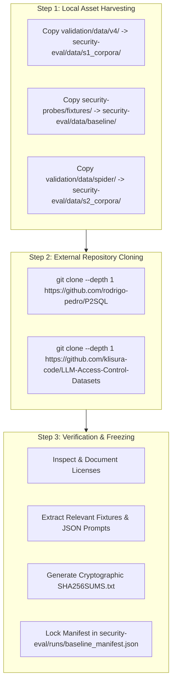

# 04_DATA_ACQUISITION_PLAN.md: Data Acquisition & Artifact Sourcing Plan

**Document Status**: Architectural Design Specification  
**Target Codebase Commit**: `9cde26cc712cd805d48c2ede925393742ec1b68d`  
**Execution Timestamp**: 2026-10-25T14:24:45Z  
**Execution Invariant**: Hard Rule 1 strictly observed. **NO files will be downloaded, cloned, or written during this session.** This document outlines the acquisition strategy to be reviewed and executed in a subsequent session.

---

## 1. Public and Internal Resource Inventory

The following table catalogs every data artifact, benchmark corpus, and repository fixture required to execute test suites S1 and S2:

| Resource Name | Source URL / Repository | Stated License | Approximate Size | Format | Primary Evaluation Use | Planned Acquisition Method | Integrity & Checksum Approach |
| :--- | :--- | :--- | :--- | :--- | :--- | :--- | :--- |
| **P2SQL Replication Package** | `https://github.com/rodrigo-pedro/P2SQL` | Research Release (*License UNKNOWN* — inspect upon download) | ~15 MB | Python, JSON prompts | S1-B: Replicating U.1–U.3, RD.1–RD.2, and RI.1–RI.2 prompt injection attacks. | Planned `git clone` to `security-eval/data/external/P2SQL` | Record git commit hash; compute SHA-256 digests of all `.json` and prompt files. |
| **Role-Conditioned Refusals (RCR)** | `https://github.com/klisura-code/LLM-Access-Control-Datasets` | Research Release (*License UNKNOWN* — inspect upon download) | ~50 MB | JSON, SQL, PostgreSQL DDL | S2-A: Grounding table/column RBAC policies and gold queries on Spider/BIRD. | Planned `git clone` to `security-eval/data/external/RCR` | Record git commit hash; compute SHA-256 digests of extracted policy JSONs. |
| **Spider Text-to-SQL Benchmark** | `https://yale-lily.github.io/spider` (Local copy exists in `validation/data/spider/`) | CC BY-SA 4.0 | ~100 MB (official) / 106 KB (local subset) | SQLite DBs, JSON (`dev.json`, `tables.json`) | S2-A & S2-B: Source relational databases (`concert_singer`, etc.) and gold SQL queries. | Extract existing local `validation/data/spider/frozen_sample_300_B.jsonl` or pull official archive. | Verify against existing `validation/data/spider/SHA256SUMS.csv`. |
| **Deepset Prompt Injections** | `https://huggingface.co/datasets/deepset/prompt-injections` (Local copy exists in `validation/data/v13/`) | CC BY-SA 4.0 | ~500 KB (972 items) | JSONL (`v13_corpus.jsonl`) | S1-B: Baseline calibration of perimeter input guard against known public attacks. | Copy from existing `validation/data/v13/v13_corpus.jsonl`. | Compute SHA-256 digest of local JSONL file (`v13_corpus.jsonl`). |
| **CogniCore Multi-Tenant Bank Fixture** | Internal: `security-probes/fixtures/` | Proprietary Workspace Asset | 148 KB | SQLite 3 (`raw_fixture.db`, 6 authorized clones) | S1-A: Driver mutation oracle testing; S2-B: 14-variant RLS mutation suite. | Copy from existing `security-probes/fixtures/` to `security-eval/data/baseline/`. | Compute SHA-256 digest of `raw_fixture.db` and all `authorized_*.db` files. |
| **Existing V4 SQL Injection Corpus** | Internal: `validation/data/v4/` | Proprietary Workspace Asset | 668 KB | JSONL (1,348 attacks, 220 benign) | S1-A: Seeding gate-level SQL injection payloads across categories CAT-01 to CAT-08. | Copy from existing `validation/data/v4/attacks.jsonl` and `benign.jsonl`. | Compute SHA-256 digest of source files. |

---

## 2. Planned Download and Acquisition Procedure (Step-by-Step Plan)

In the implementation phase (Session 2), data acquisition will be executed via the following planned sequence:



### Step 1: Harvest Existing Workspace Assets
*Copy internal corpora without network requests:*
- Copy `validation/data/v4/attacks.jsonl` and `benign.jsonl` to `security-eval/data/s1_corpora/`.
- Copy `security-probes/fixtures/raw_fixture.db` and `authorized_*.db` to `security-eval/data/baseline/`.
- Copy `validation/data/spider/frozen_sample_300_B.jsonl` to `security-eval/data/s2_corpora/`.

### Step 2: Clone External Public Research Packages
*Clone external repositories into isolated directory `security-eval/data/external/`:*
- Clone P2SQL:
  ```bash
  git clone --depth 1 https://github.com/rodrigo-pedro/P2SQL.git security-eval/data/external/P2SQL
  ```
- Clone RCR Access Control Datasets:
  ```bash
  git clone --depth 1 https://github.com/klisura-code/LLM-Access-Control-Datasets.git security-eval/data/external/RCR
  ```

### Step 3: Inspect & Confirm Licenses
- Read `security-eval/data/external/P2SQL/LICENSE` (or check `README.md` for license statements).
- Read `security-eval/data/external/RCR/LICENSE` (or check `README.md`).
- If no license is specified, record `UNKNOWN` and maintain records for academic fair-use evaluation.

### Step 4: Extract and Normalize Evaluation Fixtures
- Extract P2SQL adversarial prompts from `prompts/` and map into normalized JSONL format (`security-eval/data/s1_corpora/s1_b_p2sql.jsonl`).
- Extract RCR PostgreSQL RBAC rules and translate into CogniCore's policy format (`security-eval/data/s2_corpora/rcr_spider_policies.json`).

### Step 5: Cryptographic Integrity Lock
- Compute SHA-256 hashes for all acquired files:
  ```bash
  sha256sum security-eval/data/baseline/* security-eval/data/s1_corpora/* security-eval/data/s2_corpora/* > security-eval/data/SHA256SUMS.txt
  ```
- Commit `SHA256SUMS.txt` as the immutable evaluation data freeze.

---

## 3. Environment & Hardware Requirements

To execute test suites S1 and S2 successfully, the evaluation environment must satisfy the following criteria:

| Requirement Category | Specification | Verification Check / Command |
| :--- | :--- | :--- |
| **Node.js Runtime** | Version $\ge 20.0.0$ (native `better-sqlite3`, `node:worker_threads`, `node:test`) | `node --version` |
| **Python Environment** | Python $\ge 3.10$ with `sqlite3` standard library support | `python3 --version` |
| **Local LLM Daemon** | Ollama $\ge 0.3.0$ running at `http://localhost:11434` | `curl -s http://localhost:11434/api/tags` |
| **Installed LLM Models** | `qwen2.5:14b` (Primary evaluation model, ~9.0 GB VRAM/RAM) <br/> `qwen2.5:7b` (Secondary comparison model, ~4.7 GB VRAM/RAM) | `ollama list` |
| **System Memory (RAM)** | Minimum **16 GB RAM** (Recommended **32 GB RAM** for 14B model inference) | `free -h` |
| **Available Disk Space** | Minimum **15 GB free disk space** (Models: ~14 GB; Sandboxes & Datasets: ~1 GB) | `df -h .` |
| **Operating System** | Linux (Ubuntu 22.04+, Debian 12+, Arch, or Linux on ARM64 / x86_64) | `uname -a` |
