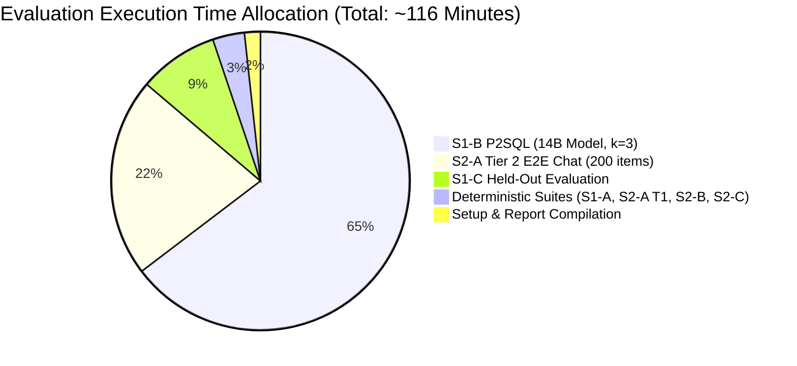

# 05_SCRIPT_INVENTORY.md: Evaluation Script Inventory & Runtime Budget

**Document Status**: Architectural Design Specification  
**Target Codebase Commit**: `9cde26cc712cd805d48c2ede925393742ec1b68d`  
**Execution Timestamp**: 2026-10-25T14:25:10Z  
**Implementation Constraint**: Design only. **NO executable scripts or code files are created during this session.**

---

## 1. Planned Script Inventory

The evaluation framework consists of 9 discrete automation scripts to be implemented in a subsequent session:

| Script Name | Purpose & Function | Input Artifacts | Output Artifacts | Primary Dependencies | Estimated Runtime |
| :--- | :--- | :--- | :--- | :--- | :---: |
| **`setup_data_and_fixtures.js`** | Clones external repos, extracts prompts/policies, seeds baseline DBs with canaries, computes `SHA256SUMS.txt`. | External URLs, local fixtures (`raw_fixture.db`) | `security-eval/data/*`, `SHA256SUMS.txt` | `axios`, `crypto`, `child_process` | ~2 min (network dependent) |
| **`run_s1_a_gate_corpus.js`** | Executes S1-A gate-level corpus (1,500 items) in-process without LLM; drives dual-connection mutation oracle. | `s1_a_gate_corpus.jsonl`, `raw_fixture.db` | `runs/<id>/raw_events.jsonl`, `s1_a_summary.json` | `better-sqlite3`, `sql.validator.js`, `logical_hash.js` | ~1.5 min |
| **`run_s1_b_p2sql.js`** | Dispatches P2SQL natural language injection attacks via HTTP chat endpoint; measures L1 $\rightarrow$ L2 $\rightarrow$ L3 funnel across configurations. | `s1_b_p2sql.jsonl`, live server | `runs/<id>/raw_events.jsonl`, `s1_b_funnel.json` | `axios`, Ollama (`qwen2.5:14b`), `canary_scanner.js` | ~75 min (LLM bounded) |
| **`run_s1_c_heldout.js`** | Evaluates independent held-out corpus (100 items) against the gate chain and live chat endpoint. | `s1_c_heldout.jsonl` | `runs/<id>/raw_events.jsonl`, `s1_c_summary.json` | `axios`, `sql.validator.js` | ~10 min |
| **`run_s2_a_tier1_enforcement.js`** | Replays 600 RCR gold SQL statements through AST validator and policy rewriter against SQLite and Postgres without LLM. | `s2_a_rcr_tier1.jsonl`, Spider databases | `runs/<id>/raw_events.jsonl`, `s2_a_tier1_results.json`| `better-sqlite3`, `data.policy.js`, `purged_clone_oracle.js` | ~45 sec |
| **`run_s2_a_tier2_e2e_chat.js`** | Executes 200 conversational natural language queries across 4 authenticated roles via `POST /api/chat`. | `s2_a_rcr_tier2.jsonl`, live server | `runs/<id>/raw_events.jsonl`, `s2_a_tier2_results.json`| `axios`, Ollama (`qwen2.5:14b`), `canary_scanner.js` | ~25 min (LLM bounded) |
| **`run_s2_b_rls_mutations.js`** | Evaluates 14-variant SQL mutation suite for row-level security; compares against purged clones. | `s2_b_row_mutations.jsonl`, `raw_fixture.db` | `runs/<id>/raw_events.jsonl`, `s2_b_matrix.json` | `better-sqlite3`, `data.policy.js`, `purged_clone_oracle.js` | ~30 sec |
| **`run_s2_c_utility_scaling.js`** | Benchmarks execution accuracy of permitted queries and measures rewriter latency as policy set scales from 1 to 50 rules. | Spider databases, synthetic policy sets | `s2_c_utility.json`, `s2_c_scaling.csv` | `better-sqlite3`, `data.policy.js` | ~1 min |
| **`compile_security_report.js`** | Aggregates all JSONL event logs from a run into publication-ready Markdown tables with Wilson score 95% CIs. | `runs/<id>/raw_events.jsonl` | `runs/<id>/SECURITY_EVALUATION_REPORT.md`| `confidence_intervals.js`, `summary_metrics.js` | ~5 sec |

---

## 2. Runtime Budget for LLM-Mediated Runs

### 2.1 Empirical Latency Grounding
From historical benchmark measurements recorded in `validation/results/SPIDER_SAMPLE_B_REPORT.md:42` and `reverse-engineering/03_llm_calls.md:15`, local inference latency for `qwen2.5:14b` via Ollama on workstation hardware (8-core CPU / 16GB+ VRAM or unified memory) averages:
- **SQL Generation (`generateSql`)**: **4.5 seconds** per request (prompt: ~800 tokens, output: ~60 tokens).
- **Answer Composition (`composeAnswer`)**: **2.5 seconds** per request.
- **Total per-query turnaround through `POST /api/chat`**: **~7.0 seconds** average (allowing for 1 retry or empty result diagnosis).
- For `qwen2.5:7b`: **~3.2 seconds** per query.

### 2.2 Granular Runtime Estimation

1. **S1-B P2SQL Evaluation**:
   - Items: 75 prompt injection attacks $\times$ 3 repetitions ($k=3$) = **225 execution requests**.
   - Model: `qwen2.5:14b` at 7.0s per request $\rightarrow$ $225 \times 7.0\text{ s} = 1,575\text{ seconds}$ (**~26.3 minutes**).
   - Secondary model: `qwen2.5:7b` at 3.5s per request $\rightarrow$ $225 \times 3.5\text{ s} = 787.5\text{ seconds}$ (**~13.1 minutes**).
   - Ablation runs (Ablation 1 & Ablation 2 on subset of 50 items $\times$ 3 = 300 requests) $\rightarrow$ **~35.0 minutes**.
   - **Subtotal S1-B**: **~74.4 minutes** (~1.25 hours).

2. **S2-A Tier 2 End-to-End Chat**:
   - Items: 50 natural language questions $\times$ 4 roles = **200 execution requests**.
   - Single trial ($k=1$): $200 \times 7.0\text{ s} = 1,400\text{ seconds}$ (**~23.3 minutes**).
   - **Subtotal S2-A Tier 2**: **~23.3 minutes**.

3. **S1-C Blind Held-Out Evaluation**:
   - Items: 100 questions (70 adversarial + 30 benign) $\times$ 1 trial = **100 requests**.
   - $100 \times 6.0\text{ s} = 600\text{ seconds}$ (**~10.0 minutes**).
   - **Subtotal S1-C**: **~10.0 minutes**.

4. **Deterministic Non-LLM Suites (S1-A, S2-A Tier 1, S2-B, S2-C)**:
   - S1-A (1,500 gate items @ ~50ms each with dual-connection sandbox): **~75 seconds**.
   - S2-A Tier 1 (600 gold SQL replays @ ~50ms each): **~30 seconds**.
   - S2-B (14 mutation operators $\times$ 20 queries @ ~50ms each): **~14 seconds**.
   - S2-C (Utility 200 queries + Scaling 700 iterations @ ~15ms each): **~15 seconds**.
   - **Subtotal Deterministic**: **~2.2 minutes**.

### 2.3 Total Evaluation Budget Summary
- **Total Estimated Duration**: **~110 to 120 minutes** (~2.0 hours) for a complete run of all suites across both models.
- **Resource Footprint**: Zero external cloud costs (100% local Ollama inference); max disk sandbox space $\approx 500\text{ MB}$.
