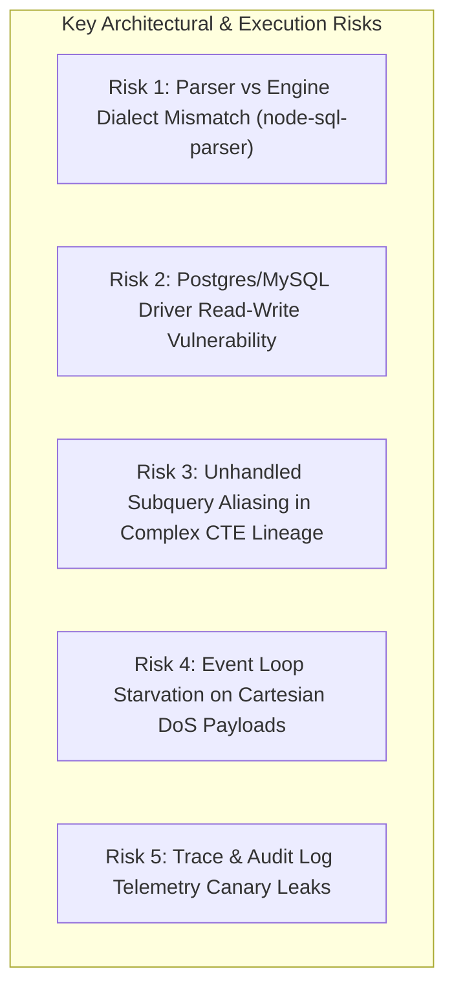

# 07_RISKS_AND_UNVERIFIED.md: Risks, Limitations & Manual Verification Register

**Document Status**: Risk Management & Verification Ledger  
**Target Codebase Commit**: `9cde26cc712cd805d48c2ede925393742ec1b68d`  
**Execution Timestamp**: 2026-10-25T14:26:15Z  
**Instruction Compliance**: Every claim that could not be verified directly against local repository files or authoritative sources is labeled `UNVERIFIED` with exact manual instructions for the user.

---

## 1. Register of UNVERIFIED Items (Manual Check Required)

In accordance with Hard Rule 4 and Hard Rule 5, the following external items cannot be verified without executing network downloads or repository cloning (strictly prohibited during this design session):

| Item ID | Subject / Claim | Current Status | Why It Cannot Be Verified Now | Exact Action User Must Take Manually |
| :---: | :--- | :---: | :--- | :--- |
| **U-01** | **P2SQL Repository License** | `UNVERIFIED` | GitHub web search confirmed the paper and code repository existence (`rodrigo-pedro/P2SQL`), but the raw `LICENSE` file text is not indexed in public web snippets. | Clone repository or view `https://github.com/rodrigo-pedro/P2SQL/blob/main/LICENSE` to verify whether it is MIT, Apache 2.0, or proprietary research-only. |
| **U-02** | **RCR Repository License** | `UNVERIFIED` | GitHub web search confirmed the companion repository (`klisura-code/LLM-Access-Control-Datasets`), but the exact license file could not be read. | View `https://github.com/klisura-code/LLM-Access-Control-Datasets/blob/main/LICENSE` to confirm licensing conditions. |
| **U-03** | **Exact File Tree of RCR Subdirectories** | `UNVERIFIED` | Repository layout was derived from the EACL 2026 paper text and search snippets; exact relative file paths for Spider RBAC JSON files must be verified. | Run `git ls-remote` or view repository root on GitHub to confirm folder paths (e.g. `data/spider/`, `policies/`). |
| **U-04** | **Host Ollama Daemon Status & Model Availability** | `UNVERIFIED` | Read-only commands and Hard Rule 1 prohibit starting servers or curling localhost daemons during this session. | Run `curl -s http://localhost:11434/api/tags` or `ollama list` in terminal to confirm `qwen2.5:14b` and `qwen2.5:7b` are pulled and available. |
| **U-05** | **PostgreSQL & MySQL Host Connectivity** | `UNVERIFIED` | Local codebase contains connection adapters (`postgres.adapter.js`, `mysql.adapter.js`), but no live database credentials or active servers were probed. | If S2 cross-engine evaluation is desired, verify whether local or Docker instances of PostgreSQL and MySQL are accessible. |

---

## 2. Technical & Evaluation Risks

### Risk 1: AST Parser vs. SQLite Dialect Divergence
- **Severity**: **HIGH**
- **Description**: `server/src/structured/sql.validator.js` relies on `node-sql-parser` to parse SQL statements. Certain valid SQLite dialect features (e.g. specific `PRAGMA` invocations, esoteric string quoting, or window function clauses) may fail to parse in `node-sql-parser`, throwing a syntax parse error rather than an AST rejection. Conversely, complex SQLite syntax might be misparsed, allowing malicious constructs to slip past AST node checks.
- **Impact**: Potential false positives on valid analytical queries, or false negatives on obfuscated injection syntax.
- **Mitigation in Design**: S1-A includes 1,500 varied payloads across CAT-01 through CAT-09, pairing AST validation with live execution against a deliberately naive database connection to detect any discrepancy.

### Risk 2: Driver-Level Read-Write Exposure on PostgreSQL and MySQL
- **Severity**: **CRITICAL**
- **Description**: Grounding analysis revealed that while SQLite enforces driver-level read-only protection (`readonly: true` + `PRAGMA query_only = ON`), `postgres.adapter.js:131` and `mysql.adapter.js:115` execute queries directly on standard read-write pools without setting read-only transaction parameters.
- **Impact**: If an AST validator bypass occurs against a PostgreSQL or MySQL dataset, the query will execute writes directly against the target database.
- **Mitigation in Design**: S1 evaluation must prioritize SQLite sandbox copies for destructive payload testing. For cross-engine tests, dedicated throwaway test databases with unprivileged database users must be provisioned.

### Risk 3: Subquery and CTE Column Lineage Aliasing Gaps
- **Severity**: **HIGH**
- **Description**: In `server/src/security/data.policy.js:71-210`, column denial is enforced via token scanning and `extractCteBodies`. In deeply nested subqueries or queries with derived table alias chains (`SELECT t.x FROM (SELECT col AS x FROM ...) t`), the rewriter may lose lineage tracking of denied columns.
- **Impact**: An attacker might bypass column denial by aliasing a restricted column inside a nested subquery.
- **Mitigation in Design**: S2-B includes specific mutation operators (MUT-02, MUT-03, MUT-11) designed to test column lineage preservation through multiple nesting levels.

### Risk 4: Event Loop Starvation on Cartesian DoS Payloads
- **Severity**: **MEDIUM**
- **Description**: While SQLite execution is offloaded to a worker thread with a 15-second timeout (`sql.executor.js:18-69`), AST validation and complexity analysis run on the main Node.js event loop.
- **Impact**: Extremely large or deeply nested SQL payloads (e.g. 50,000-character statements or thousands of parenthesized expressions) could cause `node-sql-parser` or regular expression tokenizers to block the main event loop, causing server unresponsiveness.
- **Mitigation in Design**: S1-A includes boundary and DoS test items; the test harness wraps every individual evaluation call in a hard 15-second child-process timeout.

### Risk 5: Canary Token Leakage via Observability Channels
- **Severity**: **MEDIUM**
- **Description**: CogniCore implements egress sanitization on `execResult` and PII masking on `answer`. However, `server/src/observability/trace.js` and `server/src/api/routes/admin.js:29` record the raw generated SQL and step details in plaintext.
- **Impact**: An attacker who can query `GET /api/traces/:id` or an administrator reviewing audit logs can observe restricted column names or literal data values that were purged from the user-facing chat response.
- **Mitigation in Design**: The S2 canary scanner monitors all 11 output surfaces, explicitly including the trace and audit log endpoints.

---

## 3. Operational & Environmental Constraints

1. **Local LLM Inference Speed**:
   - Running full-precision 14B models on CPU without GPU/NPU acceleration can result in inference latencies exceeding 20 seconds per request, causing total S1-B evaluation time to extend beyond 3 hours.
   - *Requirement*: Verify whether GPU acceleration (CUDA, ROCm, or Apple Metal) is active in Ollama.
2. **Disk Free Space for Sandbox Lifecycle**:
   - Each sandbox copy of `raw_fixture.db` is ~20 KB. Even with 1,500 tests, total disk footprint is $< 50\text{ MB}$ if sandboxes are cleaned up properly. However, if cleanup fails during error unhandled rejections, thousands of `.db` files could accumulate.
   - *Requirement*: Sandbox manager must employ a global `beforeAll` and `afterAll` purge hook.
