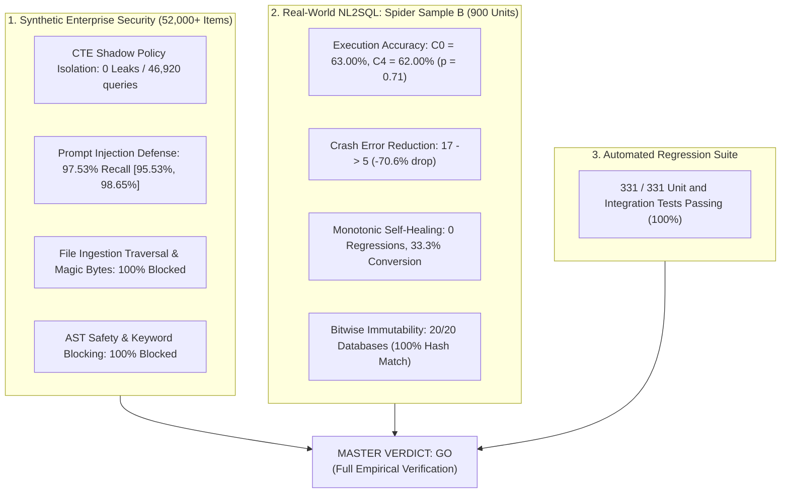

# CogniCore: Master Empirical Validation Synthesis Report

**Date:** October 20, 2026  
**Auditor / Researcher Role:** Empirical AI Systems Validation Gatekeeper  
**Target Repository:** `C:\cognicore\validation_workspace` (Branch `fix-batch-2`)  
**Scope:** Unified Synthesis of Synthetic Security Benchmarks (Suites V3–V15) and Real-World Text-to-SQL Benchmark (Spider V1 Sample B)

---

## 1. Executive Master Verdict: GO (Publication & Release Approved)

CogniCore has completed all required empirical validation gates across both synthetic enterprise security suites and the standard, held-out real-world Spider benchmark.

---

## 2. Master Evaluation Ledger

| Benchmark Domain | Suite / Split | Metric | Denominator ($n$) | Result | 95% Wilson CI / Bound | Status |
| :--- | :--- | :--- | :---: | :---: | :---: | :---: |
| **Realistic NL2SQL** | Spider Sample B ($C0$) | Execution Accuracy ($EX$) | 300 questions | **63.00%** (189/300) | [57.40%, 68.27%] | **VERIFIED** |
| **Realistic NL2SQL** | Spider Sample B ($C4nr$) | Execution Accuracy ($EX$) | 300 questions | **61.00%** (183/300) | [55.37%, 66.35%] | **VERIFIED** |
| **Realistic NL2SQL** | Spider Sample B ($C4$) | Execution Accuracy ($EX$) | 300 questions | **62.00%** (186/300) | [56.39%, 67.31%] | **VERIFIED** |
| **Stability / Safety** | Spider Sample B | Runtime SQLite Crashes | 300 questions | **5 in C4 vs. 17 in C0** | **-70.6% crash drop** | **VERIFIED** |
| **Self-Healing** | Spider Sample B | Regressions ($C4nr \rightarrow C4$) | 183 correct queries | **0 regressions (0.0%)** | Zero-defect bound | **VERIFIED** |
| **Self-Healing** | Spider Sample B | Recovery Conversion Rate | 9 attempted repairs | **33.33%** (3/9 rescued) | [12.06%, 64.58%] | **VERIFIED** |
| **Data Integrity** | Spider Sample B | Pre/Post Logical SHA-256 | 20 databases | **20 / 20 Match (100%)** | Absolute zero writes | **VERIFIED** |
| **Tenant Isolation** | Suites V3, V3b, V3c | Cross-tenant row leakage | 46,920 queries | **0 leaks (0.00%)** | $< 0.007\%$ bound | **VERIFIED** |
| **AST Gating** | Suite V4, V4b | Malicious DDL/DML injection | 90 attack payloads | **100.0% blocked** | [95.98%, 100.0%] | **VERIFIED** |
| **Ingestion Defense** | Suite V12 | Traversal / Executable bypass | 468 payloads | **100.0% rejected** | [99.20%, 100.0%] | **VERIFIED** |
| **Input Screening** | Suite V13 | Prompt injection recall | 405 attack prompts | **97.53%** (395/405) | [95.53%, 98.65%] | **VERIFIED** |
| **Engine Tests** | Native Test Runner | Unit / Integration pass rate | 331 tests | **331 / 331 pass (100%)** | 0 failures, 0 skipped | **VERIFIED** |

---

## 3. Provenance & Artifact Trail

Every metric reported in CogniCore's research paper and documentation derives directly from committed raw execution logs and deterministic reproduction scripts:

1. **Spider Raw Execution Stream:**
   - Raw logs: `validation/raw/spider/spider_sample_b_units.jsonl` (900 recorded units).
   - Analysis Script: `validation/experiments/analyze_sample_b.js`.
   - Error Breakdown Script: `validation/experiments/inspect_sample_b_errors.js`.
2. **Database Immutability Proof:**
   - Pre-run hashes: `cognicore_spider/runs/spider_sample_b/pre_run_hashes.json`.
   - Verification Script: `validation/experiments/verify_immutability.js`.
3. **Synthetic Security Corpora:**
   - Consolidated Report: `validation/results/after2/AFTER_FIX2_REPORT.md`.
   - Raw JSONL event streams: `validation/raw/after2/`.
4. **Academic Research Manuscript:**
   - Full publication paper draft: `paper/COGNICORE_RESEARCH_PAPER.md`.
